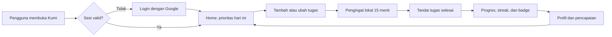

# Business Requirements Document (BRD)

## Kumi — Daily Companion untuk Manajemen Tugas Mahasiswa dan Pekerja Muda

| Atribut | Keterangan |
|---|---|
| **ID Dokumen** | KUMI-BRD-001 |
| **Versi** | 1.0 |
| **Tanggal** | 25 Oktober 2026 |
| **Status** | Draft baseline MVP untuk reviu dan persetujuan |
| **Pemilik Produk** | Tim Produk Kumi |
| **Penyusun** | Tim Penulis Produk Kumi |
| **Klasifikasi** | Internal — Proyek Akademik |
| **Menggantikan** | Bagian I pada `.projectmem/reference/01-brd-prd.md` |
| **Dokumen Terkait** | `docs/PRD.md`, `.projectmem/reference/02-architecture-deployment.md`, `.projectmem/reference/03-database-erd.md`, `.projectmem/reference/04-api-contract.md`, `.projectmem/reference/05-ui-ux-wireframe.md`, `.projectmem/reference/06-repo-guidelines.md` |

---

## Riwayat Revisi

| Versi | Tanggal | Penulis | Perubahan | Status |
|---|---|---|---|---|
| 1.0 | 25 Okt 2026 | Tim Produk Kumi | Dokumen awal: konteks bisnis, tujuan, lingkup, business requirements, metrik, risiko, dan tata kelola | Draft |

## Persetujuan

| Peran | Nama | Tanda Tangan | Tanggal |
|---|---|---|---|
| Product Owner / Ketua Tim | Tim Kumi |  |  |
| Dosen Pengampu / Penguji |  |  |  |
| Technical Lead |  |  |  |

> Dokumen dinyatakan berlaku setelah seluruh pihak pada tabel persetujuan menandatangani atau menyetujui secara tertulis melalui kanal resmi proyek.

---

## 1. Ringkasan Eksekutif

Kumi adalah aplikasi *daily companion* berbasis mobile yang membantu mahasiswa dan pekerja muda merencanakan serta menyelesaikan aktivitas harian. Berbeda dari aplikasi to-do list konvensional yang berpusat pada daftar kewajiban, Kumi menghadirkan maskot rubah interaktif yang memberi dialog kontekstual, merayakan penyelesaian tugas, dan menampilkan kemajuan melalui streak serta badge.

Produk ini dikembangkan sebagai proyek mata kuliah Pemrograman Mobile dengan arsitektur client-server: Flutter sebagai klien, FastAPI sebagai REST API, MariaDB sebagai basis data, dan deployment pada VPS publik di balik Nginx dengan HTTPS. MVP berfokus pada enam kemampuan inti: autentikasi Google, manajemen tugas berbasis waktu, profil pengguna, notifikasi lokal, gamifikasi streak dan milestone, serta micro-interaction maskot.

Dari sisi bisnis, Kumi tidak berupaya bersaing sebagai aplikasi produktivitas serba lengkap. Nilai utamanya adalah **mengurangi gesekan emosional** dalam mengelola tugas harian: masuk dengan satu ketukan, melihat prioritas hari ini dalam beberapa detik, diingatkan sebelum tenggat, dan mendapat apresiasi ketika tugas selesai. Keberhasilan MVP diukur melalui aktivasi, retensi awal, jumlah tugas yang diselesaikan, keterlibatan maskot, keandalan layanan, dan kelulusan kriteria penerimaan produk.

Per 25 Oktober 2026, implementasi kode MVP sudah mencakup sebagian besar kemampuan inti dan telah memiliki automated test pada backend serta widget test pada Flutter. Namun, status keseluruhan belum siap untuk demo produksi karena integrasi Google OAuth, pengujian pada perangkat fisik, provisioning MariaDB, deployment VPS, dan verifikasi HTTPS belum diselesaikan. BRD ini menetapkan baseline kebutuhan bisnis; rincian produk dan status implementasi per fitur diuraikan pada `docs/PRD.md`.

---

## 2. Latar Belakang dan Konteks Bisnis

### 2.1 Konteks

Mahasiswa dan pekerja muda hidup dengan jadwal yang tersebar di banyak kanal: grup percakapan, catatan digital, kalender, email, dan pengingat informal. Kebutuhan mereka bukan sekadar “mencatat tugas”, melainkan **memutuskan apa yang perlu dikerjakan hari ini dan menjaga konsistensi sampai selesai**.

Aplikasi to-do list yang ada umumnya optimal untuk pengguna yang sudah disiplin. Aplikasi tersebut menyediakan daftar, label, dan filter, tetapi jarang memberikan alasan emosional untuk kembali setiap hari. Akibatnya, banyak pengguna berhenti setelah minggu pertama ketika daftar tugas terasa seperti tumpukan kewajiban.

Kumi mengambil posisi yang berbeda: **pendamping kecil yang membuat kemajuan terasa terlihat dan dihargai**, bukan aplikasi yang menuntut produktivitas.

### 2.2 Problem Statement

| Kode | Masalah | Dampak bagi Pengguna | Dampak bagi Produk |
|---|---|---|---|
| P-01 | Jadwal dan tugas tersebar di banyak tempat | Pengguna harus mengingat dan menyusun ulang prioritas setiap hari | Aplikasi baru harus memiliki alasan jelas untuk digunakan, bukan menambah satu kanal lagi |
| P-02 | To-do list terasa seperti kewajiban | Pengguna menunda membuka aplikasi, terutama saat daftar panjang | Retensi rendah setelah minggu pertama |
| P-03 | Penyelesaian tugas tidak memberi umpan balik yang terasa | Motivasi menurun; pengguna tidak melihat kemajuan | Fitur gamifikasi harus relevan, bukan sekadar dekorasi |
| P-04 | Pengingat sering terlewat atau terlalu banyak | Tenggat terlewat atau pengguna mematikan notifikasi | Notifikasi harus tepat, terbatas, dan mudah dikendalikan |

**Pernyataan masalah:** Pengguna muda membutuhkan cara yang ringan dan suportif untuk melihat prioritas harian, diingatkan pada waktu yang tepat, dan merasakan kemajuan atas tugas yang telah diselesaikan.

### 2.3 Peluang

- **Kebutuhan emosional belum terlayani.** Sebagian besar aplikasi produktivitas bersaing pada jumlah fitur, bukan pada rasa ditemani.
- **Google Workspace sudah menjadi identitas utama** target pengguna, sehingga login Google menurunkan gesekan adopsi.
- **Notifikasi lokal cukup untuk MVP.** Pendekatan ini menghindari biaya dan kompleksitas layanan push.
- **Data tugas memiliki nilai lanjutan.** Riwayat tugas dan waktu penyelesaian dapat menjadi fondasi fitur rekomendasi atau prediksi prioritas di masa depan.
- **Konteks akademik memberi ruang eksperimen.** Tim dapat memvalidasi pengalaman, arsitektur, dan kualitas teknis tanpa tekanan komersial penuh.

### 2.4 Asumsi Validasi

Problem statement di atas merupakan hipotesis yang disusun dari observasi kebutuhan pengguna dan riset sekunder. MVP ini **belum melalui riset kuantitatif formal**. Validasi dilakukan melalui demo terbatas, pengamatan penggunaan, dan metrik yang dihitung manual dari basis data.

---

## 3. Tujuan Bisnis dan Metrik Keberhasilan

### 3.1 Tujuan Bisnis

| Kode | Tujuan | Alasan | Target | Horizon |
|---|---|---|---|---|
| BO-01 | Memvalidasi bahwa Kumi menyelesaikan masalah prioritas harian | Memastikan produk bukan sekadar eksperimen teknis | ≥ 20 pengguna terdaftar pada periode demo | Demo akhir semester |
| BO-02 | Mendorong aktivasi pengguna baru | Pengguna yang tidak membuat tugas pertama tidak akan merasakan nilai | ≥ 70% pengguna membuat ≥ 1 tugas dalam 24 jam pertama | 1 minggu setelah rilis demo |
| BO-03 | Menguji daya tarik pendampingan | Maskot adalah pembeda utama; harus benar-benar digunakan | ≥ 50% sesi memiliki ≥ 1 interaksi maskot | Periode demo |
| BO-04 | Menjaga konsistensi penggunaan | Nilai produk muncul saat digunakan berulang | ≥ 40% pengguna kembali pada hari ke-2 | 2 hari setelah aktivasi |
| BO-05 | Membuktikan keandalan layanan | Demo dan penilaian membutuhkan sistem yang stabil | Uptime API ≥ 99% selama periode demo; p95 < 500 ms | Periode demo |
| BO-06 | Menghasilkan fondasi teknis yang dapat dilanjutkan | Proyek tidak berhenti setelah demo akademik | Kode, test, dokumentasi, dan deployment dapat dijalankan ulang | Akhir semester |

### 3.2 Metrik Keberhasilan

| Kode | Metrik | Definisi | Target MVP | Sumber Data | Frekuensi |
|---|---|---|---|---|---|
| KPI-01 | Pengguna terdaftar | Jumlah baris `users` yang berasal dari Google Sign-In | ≥ 20 | Basis data | Harian |
| KPI-02 | Aktivasi | Pengguna dengan ≥ 1 tugas dibuat dalam 24 jam setelah pendaftaran | ≥ 70% | `users.created_at`, `tasks.created_at` | Harian |
| KPI-03 | Retensi D2 | Pengguna yang kembali pada hari ke-2 setelah aktivasi | ≥ 40% | Perlu instrumentasi sesi/login | Harian |
| KPI-04 | Tugas selesai per pengguna per minggu | Rata-rata tugas dengan `is_completed = true` per pengguna aktif | ≥ 5 | Basis data | Mingguan |
| KPI-05 | Keterlibatan maskot | Rasio sesi dengan ≥ 1 tap maskot | ≥ 50% | Perlu instrumentasi event | Harian |
| KPI-06 | Keandalan | Persentase waktu `/health` mengembalikan status sehat | ≥ 99% | Monitoring manual | Selama demo |
| KPI-07 | Performa | Persentil ke-95 waktu respons endpoint CRUD | < 500 ms | Log akses | Selama demo |
| KPI-08 | Kualitas rilis | Persentase kriteria penerimaan P0 yang lulus UAT | 100% | UAT checklist | Sebelum demo |
| KPI-09 | Keamanan | Insiden kebocoran data atau akses lintas pengguna | 0 | Audit dan test | Berkelanjutan |

> **Catatan pengukuran:** KPI-03 dan KPI-05 belum dapat dihitung dari skema saat ini karena belum ada pencatatan event login maupun tap maskot. Instrumentasi minimum diperlukan sebelum kedua metrik tersebut dapat dilaporkan. Rincian ada pada `docs/PRD.md` bagian 10 dan Lampiran B.

### 3.3 Prinsip Pengukuran

1. **Minim data.** Hanya data yang diperlukan untuk produk dan evaluasi yang dikumpulkan.
2. **Tanpa pihak ketiga pada MVP.** Tidak ada SDK analitik eksternal; metrik dihitung dari basis data dan log server.
3. **Dapat diaudit.** Setiap angka harus dapat ditelusuri ke query atau log yang terdokumentasi.
4. **Tidak mengorbankan privasi.** Data tugas tidak boleh dipakai untuk iklan atau dibagikan ke pihak lain.

---

## 4. Ruang Lingkup

### 4.1 In-Scope (MVP)

| Kode | Kemampuan | Hasil Bisnis yang Diharapkan | Prioritas |
|---|---|---|---|
| S-01 | Login dengan Google | Pengguna masuk tanpa membuat kata sandi baru | Must |
| S-02 | Manajemen tugas (buat, lihat, ubah, hapus) | Pengguna dapat merencanakan dan memperbarui aktivitas harian | Must |
| S-03 | Tampilan hari ini dan progres harian | Pengguna mengetahui prioritas dalam < 5 detik | Must |
| S-04 | Notifikasi lokal sebelum tenggat | Pengguna tidak melewatkan tugas penting | Must |
| S-05 | Streak dan badge | Pengguna melihat konsistensi dan pencapaian | Must |
| S-06 | Maskot dengan dialog kontekstual | Pengguna merasakan pendampingan, bukan sekadar checklist | Must |
| S-07 | Profil dan edit nama | Pengguna dapat melihat identitas, statistik, dan pencapaian | Must |
| S-08 | Deployment publik dengan HTTPS | Aplikasi dapat diakses dari perangkat melalui internet | Must |
| S-09 | Dokumentasi dan automated test | Proyek dapat dijalankan, diuji, dan dinilai | Must |
| S-10 | Aksesibilitas dasar dan bahasa Indonesia | Produk dapat digunakan oleh target pengguna secara inklusif | Should |

### 4.2 Out-of-Scope (MVP)

| Kode | Fitur | Alasan Dikeluarkan | Rencana Lanjutan |
|---|---|---|---|
| O-01 | Login manual (email + kata sandi) | Menambah permukaan keamanan dan alur pemulihan akun tanpa nilai proporsional untuk MVP | Ditinjau setelah validasi pasar |
| O-02 | Chatbot NLP / LLM | Biaya, kualitas, penyalahgunaan, dan kompleksitas evaluasi | Dialog berbasis aturan menjadi fondasi |
| O-03 | Model Machine Learning aktif | Data historis belum memadai; evaluasi model di luar cakupan semester | Skema data disiapkan untuk eksperimen |
| O-04 | Sinkronisasi multi-perangkat real-time | Memerlukan WebSocket dan resolusi konflik | REST cukup untuk MVP |
| O-05 | Kolaborasi atau pembagian tugas | Di luar persona utama | Kandidat v2 |
| O-06 | Integrasi Google Calendar | Menambah scope OAuth dan sinkronisasi dua arah | Kandidat v1.1 |
| O-07 | Push notification (FCM/APNs) | Notifikasi lokal sudah memenuhi kebutuhan pengingat | Dipertimbangkan bila ada kebutuhan lintas perangkat |
| O-08 | Pembayaran atau langganan | Tidak relevan untuk proyek akademik | Tidak direncanakan |
| O-09 | Widget home screen | Memerlukan native code per platform | Kandidat v1.1 |
| O-10 | Dark mode | Nice-to-have; tema tunggal lebih cepat divalidasi | Kandidat v1.1 |
| O-11 | Analitik pihak ketiga | Privasi dan biaya | Metrik internal/manual |
| O-12 | Multi-bahasa | Fokus pada kualitas bahasa Indonesia | Kandidat v1.1 |
| O-13 | Penghapusan akun mandiri | Belum diwajibkan untuk demo; tetap perlu ditinjau sebelum rilis publik | Kandidat v1.1 |
| O-14 | Aplikasi web/desktop | Fokus mobile | Tidak direncanakan untuk MVP |

### 4.3 Batas Rilis MVP

MVP dinyatakan selesai apabila:

1. Seluruh kebutuhan berprioritas **Must** pada `docs/PRD.md` terimplementasi dan lulus UAT.
2. Aplikasi dapat dipasang pada perangkat Android fisik dan terhubung ke API publik melalui HTTPS.
3. Login Google berhasil dengan akun uji yang sah.
4. CRUD tugas, streak, minimal dua badge, dan dialog maskot dapat didemonstrasikan end-to-end.
5. Notifikasi lokal muncul pada perangkat uji.
6. `pytest`, `flutter analyze`, dan `flutter test` lulus.
7. README memuat langkah menjalankan aplikasi dan API dari nol.

---

## 5. Stakeholder

| Stakeholder | Peran | Kepentingan Utama | RACI |
|---|---|---|---|
| Tim Produk Kumi | Pemilik produk dan pelaksana | Lingkup, kualitas, ketepatan waktu | A/R |
| Dosen Pengampu | Penilai akademik | Kesesuaian dengan ketentuan tugas, kualitas rekayasa | C/I |
| Pengguna uji (mahasiswa/pekerja muda) | Pengguna akhir | Aplikasi mudah, cepat, dan terasa suportif | C/I |
| Google Identity | Penyedia identitas | Kepatuhan OAuth dan kebijakan penggunaan | I |
| Penyedia VPS dan domain | Infrastruktur | Layanan stabil dan aman | I |
| QA / Dokumentasi | Penjamin mutu | Kriteria penerimaan terverifikasi | R |
| Rekan tim pengembang | Implementasi | Kebutuhan jelas dan dapat diuji | R |

**Keterangan RACI:** R = Responsible, A = Accountable, C = Consulted, I = Informed.

---

## 6. Pengguna Sasaran dan Persona

### 6.1 Segmen Utama

**Mahasiswa aktif (18–24 tahun).**
Jadwal kuliah tidak teratur, banyak tugas dengan tenggat berbeda, aktif menggunakan Google Workspace, dan sensitif terhadap aplikasi yang terasa berat. Kebutuhan utama: melihat prioritas hari ini dengan cepat, diingatkan sebelum tenggat, dan merasa termotivasi untuk menyelesaikan tugas.

**Pekerja muda / early career (22–30 tahun).**
Menggabungkan pekerjaan, side project, dan kegiatan pribadi. Mobilitas tinggi, menghargai antarmuka ringan dan estetis. Kebutuhan utama: memisahkan dan memprioritaskan tugas harian, menjaga konsistensi, serta mendapat umpan balik yang menyenangkan.

### 6.2 Segmen Sekunder

- Mahasiswa yang menyusun skripsi atau tugas akhir dan perlu memecah pekerjaan besar menjadi item harian.
- Pengguna yang pernah gagal mempertahankan kebiasaan dengan to-do list konvensional dan mencari pendekatan yang lebih suportif.

### 6.3 Persona Ringkas

| Persona | Profil | Perilaku | Kebutuhan | Risiko Churn |
|---|---|---|---|---|
| **Rani** | 20 tahun, mahasiswa semester 4 | Membuka aplikasi di sela kuliah; menyukai ilustrasi lucu | Tahu “apa yang harus dikerjakan hari ini” dalam 5 detik | Berhenti jika harus mengetik banyak atau melihat layar kosong |
| **Dimas** | 25 tahun, junior analyst | Memakai aplikasi pagi dan malam; menghargai progres | Menutup hari dengan melihat progres dan streak | Terganggu jika notifikasi berlebihan |

### 6.4 Jobs To Be Done

| Kode | Job | Konteks | Kriteria Sukses |
|---|---|---|---|
| JTBD-01 | “Bantu saya tahu apa yang harus dikerjakan hari ini.” | Pagi atau sela kuliah | Prioritas terlihat tanpa membuka banyak layar |
| JTBD-02 | “Ingatkan saya sebelum tenggat.” | Tenggat tugas | Notifikasi muncul tepat waktu dan tidak berulang |
| JTBD-03 | “Beri saya alasan untuk kembali besok.” | Setelah menyelesaikan tugas | Streak dan badge terasa berarti |
| JTBD-04 | “Temani saya tanpa mengganggu.” | Penggunaan harian | Maskot hadir sebagai pendamping, bukan penghalang |

---

## 7. Value Proposition

| Dimensi | To-do List Konvensional | Kumi |
|---|---|---|
| Interaksi | Daftar statis | Maskot rubah yang merespons sentuhan |
| Umpan balik | Centang tanpa apresiasi | Dialog kontekstual, animasi perayaan, streak |
| Motivasi | Bergantung pada disiplin pengguna | Gamifikasi ringan: streak dan milestone badge |
| Nada produk | Netral dan korporat | Playful, hangat, personal |
| Retensi | Rendah setelah minggu pertama | Alasan emosional untuk kembali setiap hari |
| Gesekan masuk | Membuat akun dan kata sandi | Login satu ketukan dengan Google |

**Pernyataan nilai:** *Kumi membuat pengelolaan jadwal harian terasa seperti ditemani teman kecil yang merayakan kemajuanmu, bukan seperti daftar kewajiban yang menuntut.*

Tiga pilar nilai:

1. **Companion, bukan checklist.** Maskot hadir di layar utama dan memberi respons relevan terhadap waktu dan aktivitas pengguna.
2. **Progress yang terlihat.** Progress bar harian, streak, dan badge memberi bukti kemajuan yang konkret.
3. **Gesekan rendah.** Login satu ketukan, tambah tugas dalam satu modal, dan notifikasi otomatis di perangkat.

---

## 8. Business Requirements

### 8.1 Skala Prioritas

| Prioritas | Arti |
|---|---|
| **Must** | Wajib ada pada MVP; tanpa ini rilis tidak sah |
| **Should** | Penting, tetapi dapat ditunda dengan catatan risiko |
| **Could** | Nice-to-have; dikerjakan bila waktu memungkinkan |
| **Won’t** | Dinyatakan di luar lingkup untuk rilis ini |

### 8.2 Daftar Business Requirement

| ID | Business Requirement | Rasional | Prioritas | Kriteria Penerimaan Bisnis | Referensi PRD |
|---|---|---|---|---|---|
| **BR-01** | Pengguna dapat masuk menggunakan akun Google dan tetap masuk selama sesi valid | Mengurangi gesekan adopsi dan menghilangkan kebutuhan kata sandi | Must | Minimal satu akun uji berhasil masuk; pengguna lama tidak diminta login ulang selama token valid; keluar menghapus sesi | FR-AUTH-01–07 |
| **BR-02** | Pengguna dapat membuat, melihat, mengubah, dan menghapus tugas beserta tenggat | Inti nilai produk adalah perencanaan tugas harian | Must | Seluruh operasi CRUD berhasil end-to-end; data hanya terlihat oleh pemiliknya | FR-TASK-01–09 |
| **BR-03** | Pengguna dapat melihat prioritas hari ini dan progres harian | Mengurangi beban kognitif dan mempercepat pengambilan keputusan | Must | Home menampilkan tugas hari ini, progres selesai/total, dan maksimal tiga tugas berikutnya | FR-HOME-01–07 |
| **BR-04** | Pengguna menerima pengingat lokal sebelum tenggat | Tenggat terlewat adalah kegagalan utama produk | Must | Notifikasi muncul 15 menit sebelum tenggat; dibatalkan saat tugas selesai atau dihapus; tidak dijadwalkan untuk tenggat lampau | FR-NOTIF-01–07 |
| **BR-05** | Pengguna dapat menandai tugas selesai dengan satu ketukan dan menerima umpan balik | Umpan balik instan adalah pembeda pengalaman | Must | Status berubah tanpa reload manual; maskot merespons penyelesaian; progres diperbarui | FR-TASK-06, FR-KUMI-06 |
| **BR-06** | Pengguna memiliki streak harian yang dihitung dari konsistensi penyelesaian tugas | Streak memberi alasan untuk kembali setiap hari | Must | Satu hari dengan ≥ 1 tugas selesai dihitung satu kali; streak putus setelah satu hari kosong | FR-GAM-01–02 |
| **BR-07** | Pengguna dapat meraih badge pada ambang pencapaian tertentu | Memberi rasa bangga dan tujuan jangka menengah | Must | Enam badge MVP tersedia; badge hanya diberikan sekali; status diraih/belum terlihat | FR-GAM-03–06 |
| **BR-08** | Maskot memberi dialog kontekstual dan tidak menghalangi alur kerja | Pengalaman pendampingan adalah proposisi utama | Must | Tap maskot menampilkan dialog sesuai konteks waktu/status; ada fallback offline; tidak menumpuk bubble | FR-KUMI-01–08 |
| **BR-09** | Pengguna dapat melihat profil, statistik, dan pencapaian serta mengubah nama tampilan | Personalisasi meningkatkan rasa memiliki | Must | Profil menampilkan identitas Google, streak, total selesai, dan badge; nama hasil edit tidak ditimpa Google | FR-PROF-01–06 |
| **BR-10** | Data pengguna terisolasi dan hanya data minimum yang disimpan | Kepercayaan dan kepatuhan privasi | Must | Tidak ada akses lintas pengguna; tidak ada kata sandi; data yang disimpan hanya nama, email, foto, dan tugas | FR-SYS-01, NFR-05–06 |
| **BR-11** | Layanan dapat diakses publik melalui HTTPS dan tetap sehat selama demo | Demo dan penilaian membutuhkan akses nyata | Must | `https://api.<domain>/health` mengembalikan status sehat; HTTP dialihkan ke HTTPS; API tidak terekspos langsung tanpa proxy | FR-SYS-03, FR-SYS-06 |
| **BR-12** | Produk dapat diukur, dioperasikan, dan diuji secara konsisten | Menjaga kualitas dan memungkinkan evaluasi akademik | Must | Test backend dan Flutter lulus; README dapat diikuti dari nol; metrik inti dapat dihitung | FR-SYS-07–12, NFR-11–14 |
| **BR-13** | Antarmuka menggunakan bahasa Indonesia dan aksesibel secara dasar | Target pengguna berbahasa Indonesia dan beragam kemampuan | Should | Teks utama berbahasa Indonesia; target sentuh ≥ 48 dp; kontras WCAG AA; reduce motion dihormati | NFR-07–10 |
| **BR-14** | Skema data siap untuk pengembangan fitur cerdas di masa depan | Menghindari migrasi besar setelah MVP | Could | Riwayat tugas, tenggat, dan waktu penyelesaian tersimpan lengkap | Lampiran data PRD |

### 8.3 Business Rules

| ID | Aturan Bisnis | Alasan |
|---|---|---|
| **BR-RULE-01** | Setiap tugas dimiliki tepat satu pengguna; akses tugas pengguna lain menghasilkan `404` | Mencegah kebocoran keberadaan data |
| **BR-RULE-02** | Tugas baru wajib memiliki judul dan tenggat di masa depan | Menjaga kualitas daftar dan relevansi pengingat |
| **BR-RULE-03** | Menandai selesai bersifat idempoten; `completed_at` tidak berubah bila status selesai dikirim ulang | Mencegah duplikasi dan data waktu yang tidak konsisten |
| **BR-RULE-04** | Streak dihitung dari tanggal penyelesaian; beberapa tugas pada hari yang sama dihitung satu hari | Menjaga definisi streak sederhana dan adil |
| **BR-RULE-05** | Badge tidak diberikan dua kali untuk pengguna yang sama | Mencegah duplikasi pencapaian |
| **BR-RULE-06** | Badge yang sudah diraih bersifat permanen pada MVP; tidak dicabut saat tugas dibatalkan atau dihapus | Menghindari kehilangan pencapaian yang membingungkan pengguna |
| **BR-RULE-07** | Pengingat lokal dijadwalkan 15 menit sebelum tenggat; tidak ada pengingat untuk tenggat lampau | Sesuai kebutuhan MVP dan mengurangi notifikasi yang tidak berguna |
| **BR-RULE-08** | Nama tampilan yang diubah pengguna tidak ditimpa data Google saat login berikutnya | Menghormati personalisasi pengguna |
| **BR-RULE-09** | Dialog maskot dipilih berdasarkan konteks `morning`, `afternoon`, `night`, `task_done`, atau `idle` | Menjaga relevansi dan konsistensi pengalaman |
| **BR-RULE-10** | MVP tidak menghapus akun secara otomatis; permintaan penghapusan ditangani manual | Keterbatasan lingkup akademik; perlu ditinjau sebelum rilis publik |

---

## 9. Proses Bisnis

### 9.1 Kondisi Saat Ini

1. Pengguna mencatat tugas di beberapa tempat: chat, catatan, kalender, atau ingatan.
2. Pengguna menyusun prioritas secara manual setiap kali membuka aplikasi yang berbeda.
3. Pengingat tidak konsisten; beberapa tugas terlewat.
4. Setelah tugas selesai, tidak ada umpan balik yang terasa; motivasi menurun.
5. Aplikasi to-do konvensional ditinggalkan setelah beberapa hari.

### 9.2 Kondisi yang Dituju

1. Pengguna membuka Kumi dan langsung melihat prioritas hari ini.
2. Pengguna menambah atau menyesuaikan tugas dalam satu modal.
3. Perangkat menjadwalkan pengingat sebelum tenggat.
4. Pengguna menandai tugas selesai dan melihat progres, streak, serta reaksi maskot.
5. Pengguna kembali keesokan hari karena ada alasan emosional dan progres yang terlihat.

### 9.3 Alur Nilai Tingkat Tinggi

### 9.4 Titik Sentuh Bisnis

| Tahap | Titik Sentuh | Metrik Terkait |
|---|---|---|
| Akuisisi | Undangan demo, kelas, dan jaringan pengguna awal | KPI-01 |
| Aktivasi | Login Google dan pembuatan tugas pertama | KPI-02 |
| Keterlibatan | Tap maskot, penyelesaian tugas | KPI-04, KPI-05 |
| Retensi | Kembali pada hari ke-2 dan seterusnya | KPI-03 |
| Keandalan | Health check dan demo | KPI-06, KPI-07 |
| Kepercayaan | Isolasi data dan penanganan sesi | KPI-09 |

---

## 10. Business Case

### 10.1 Pendorong Biaya

| Kategori | Deskripsi | Skala |
|---|---|---|
| Infrastruktur | Satu VPS kecil untuk API, MariaDB, dan Nginx | Rendah |
| Domain | Satu domain atau subdomain untuk API | Rendah |
| TLS | Let’s Encrypt | Gratis |
| Identitas | Google Identity | Gratis untuk skala MVP |
| Pengembangan | Waktu tim sebagai bagian dari proyek akademik | Utama |
| Operasi | Backup manual, monitoring sederhana | Rendah |

### 10.2 Manfaat

| Jenis | Manfaat | Ukuran |
|---|---|---|
| Bagi pengguna | Prioritas harian lebih cepat dipahami; pengingat lebih konsisten; kemajuan terasa | KPI-02, KPI-04 |
| Bagi tim | Bukti kemampuan rekayasa end-to-end: mobile, API, basis data, deployment, keamanan | Kelulusan dan portofolio |
| Bagi produk | Fondasi untuk fitur lanjutan: kalender, rekomendasi, model prioritas | Kesiapan skema dan arsitektur |
| Bagi akademik | Studi kasus penerapan arsitektur client-server dan gamifikasi | Dokumentasi dan demo |

### 10.3 Pernyataan Business Case

Kumi adalah investasi berskala kecil dengan biaya operasional rendah dan manfaat utama berupa **validasi pengalaman, pembelajaran rekayasa, serta fondasi produk yang dapat dilanjutkan**. Proyek ini tidak menargetkan laba komersial pada MVP; keberhasilan diukur melalui penggunaan nyata, kualitas teknis, dan pemenuhan kriteria akademik.

---

## 11. Asumsi, Kendala, dan Dependensi

### 11.1 Asumsi

| ID | Asumsi | Dampak Jika Salah |
|---|---|---|
| A-01 | Pengguna memiliki akun Google aktif | Login tidak dapat dilakukan |
| A-02 | Pengguna memiliki perangkat Android atau iOS yang mendukung Flutter | Target perangkat menyempit |
| A-03 | Koneksi internet tersedia saat login dan sinkronisasi | Aplikasi hanya dapat menampilkan data lokal yang terbatas |
| A-04 | Skala demo ≤ 50 pengguna dan ≤ 1.000 tugas | Kapasitas infrastruktur perlu ditinjau ulang |
| A-05 | Satu VPS cukup untuk API dan basis data | Diperlukan pemisahan layanan dan biaya tambahan |
| A-06 | Waktu pengguna disimpan dalam UTC dan ditampilkan lokal | Perbedaan hari lokal dapat memengaruhi filter dan streak |
| A-07 | Google OAuth consent screen dapat dikonfigurasi untuk akun uji | Login gagal pada perangkat uji |

### 11.2 Kendala

| ID | Kendala | Implikasi |
|---|---|---|
| C-01 | Durasi pengerjaan satu semester | Prioritas harus ketat; fitur nice-to-have ditunda |
| C-02 | Tim kecil dengan peran rangkap | Bus factor tinggi; dokumentasi wajib |
| C-03 | Anggaran minimal | Tidak ada layanan berbayar, analitik pihak ketiga, atau push notification |
| C-04 | Stack ditentukan: Flutter, FastAPI, MariaDB | Pilihan teknologi tidak menjadi variabel bebas |
| C-05 | Tidak ada penyimpanan kata sandi | Autentikasi bergantung pada Google |
| C-06 | Bahasa antarmuka Indonesia | Lokalisasi multi-bahasa ditunda |
| C-07 | Demo akademik memiliki tenggat tetap | Deployment dan UAT harus diselesaikan lebih awal |

### 11.3 Dependensi

| ID | Dependensi | Pemilik | Dampak |
|---|---|---|---|
| D-01 | Google Cloud Console dan OAuth Client ID | Tim | Login tidak berfungsi tanpa konfigurasi yang benar |
| D-02 | VPS, domain, dan akses DNS | Tim/Penyedia | Aplikasi tidak dapat diakses publik |
| D-03 | Let’s Encrypt | Penyedia/Tim | HTTPS tidak valid |
| D-04 | Flutter SDK dan paket pub.dev | Ekosistem | Build dan notifikasi bergantung pada versi paket |
| D-05 | MariaDB 11.4 | Tim | Perbedaan perilaku dengan SQLite dapat muncul |
| D-06 | Perangkat fisik untuk UAT | Tim/Penguji | Notifikasi dan login tidak dapat diverifikasi penuh |
| D-07 | Ketersediaan dosen/penguji | Akademik | Jadwal UAT dan demo |

---

## 12. Risiko dan Mitigasi

Skala: Likelihood (L) dan Impact (I) 1–5; Skor = L × I. Tingkat: **Tinggi** ≥ 15, **Sedang** 8–14, **Rendah** ≤ 7.

| ID | Risiko | L | I | Skor | Tingkat | Mitigasi | Pemilik |
|---|---|---|---|---|---|---|---|
| R-01 | Konfigurasi Google OAuth salah (client ID, package, SHA-1) | 3 | 5 | 15 | Tinggi | Uji login di perangkat fisik sejak awal; siapkan akun uji; dokumentasikan langkah Cloud Console | Tim |
| R-02 | VPS atau container mati saat demo | 2 | 5 | 10 | Sedang | Siapkan rekaman demo, lingkungan lokal cadangan, dan health check | Tim |
| R-03 | Notifikasi tidak muncul di perangkat tertentu | 3 | 3 | 9 | Sedang | Uji Android 13+ dan iOS; jelaskan izin; sediakan status nonaktif | Tim |
| R-04 | Cakupan melebar (chatbot, ML, calendar) | 3 | 4 | 12 | Sedang | Tegakkan matriks out-of-scope; perubahan lingkup harus disetujui | Product Owner |
| R-05 | Kebocoran data atau akses lintas pengguna | 2 | 5 | 10 | Sedang | Isolasi `user_id`, JWT, HTTPS, secret di environment, audit test | Tim |
| R-06 | Perbedaan zona waktu menyebabkan filter/streak salah | 4 | 3 | 12 | Sedang | Definisikan zona waktu produk; uji batas hari; perbaiki sebelum UAT | Tim |
| R-07 | Kode belum di-commit dan hilang | 3 | 5 | 15 | Tinggi | Commit bertahap, remote backup, branch `development` | Tim |
| R-08 | Bus factor tinggi karena tim kecil | 3 | 4 | 12 | Sedang | Dokumentasi arsitektur, README, dan pembagian pengetahuan | Tim |
| R-09 | Perbedaan SQLite (test) dan MariaDB (produksi) | 3 | 3 | 9 | Sedang | Integration test terhadap MariaDB; verifikasi DDL dan tipe data | Tim |
| R-10 | App ID masih `com.example.kumi` dan release memakai debug signing | 4 | 4 | 16 | Tinggi | Tetapkan app ID final, buat keystore release, daftarkan SHA-1 | Tim |
| R-11 | Metrik retensi dan maskot tidak dapat dihitung | 4 | 2 | 8 | Sedang | Tambahkan instrumentasi event minimum atau sesuaikan target metrik | Product Owner |
| R-12 | Dokumentasi dan implementasi tidak sinkron | 4 | 3 | 12 | Sedang | Review dokumen setiap perubahan perilaku; status implementasi di PRD | Tim |

---

## 13. Milestone dan Timeline

| Milestone | Output | Kriteria Selesai | Status per 25 Okt 2026 | Target |
|---|---|---|---|---|
| M1 — Discovery dan baseline | BRD, PRD, arsitektur, ERD, kontrak API, UI/UX | Dokumen disetujui dan saling konsisten | Selesai | Oktober 2026 |
| M2 — Backend MVP | REST API, model data, seed, automated test | 12 endpoint fungsional berjalan; `pytest` lulus | Selesai (kode) | Oktober 2026 |
| M3 — Flutter MVP | Layar, state, repository, notifikasi | `flutter analyze` bersih; widget test lulus | Selesai (kode) | Oktober 2026 |
| M4 — Integrasi dan QA perangkat | Login Google nyata, MariaDB, notifikasi, UAT | Seluruh kriteria P0 lulus di perangkat fisik | Berjalan | Sebelum deployment |
| M5 — Deployment produksi | VPS, Nginx, HTTPS, backup | `/health` publik sehat; aplikasi terpasang dapat mengakses API | Belum dimulai | Sebelum demo |
| M6 — UAT dan demo | Skenario demo, data uji, presentasi | Demo end-to-end berhasil tanpa intervensi manual | Belum dimulai | Akhir semester |
| M7 — Handover | README, panduan operasi, arsip | Tim lain dapat menjalankan dari nol | Belum dimulai | Akhir semester |

> Tanggal pasti demo mengikuti kalender akademik. Seluruh milestone M4–M7 berstatus **belum selesai** dan menjadi fokus utama setelah baseline kode.

---

## 14. Tata Kelola dan Kontrol Perubahan

### 14.1 Peran Pengambilan Keputusan

| Keputusan | Pengambil Keputusan | Konsultasi |
|---|---|---|
| Perubahan lingkup MVP | Product Owner | Dosen pengampu, tim |
| Perubahan arsitektur | Technical Lead | Tim |
| Perubahan kontrak API | Technical Lead + Flutter developer | Tim |
| Penundaan fitur | Product Owner | Tim |
| Persetujuan rilis | Product Owner + Dosen pengampu | QA |

### 14.2 Kontrol Perubahan

1. Setiap perubahan lingkup diajukan melalui **Change Request** yang memuat alasan, dampak pada jadwal, dampak teknis, dan risiko.
2. Perubahan yang disetujui harus memperbarui `docs/BRD.md`, `docs/PRD.md`, dan dokumen teknis terkait.
3. Perubahan kecil yang tidak mengubah perilaku cukup dicatat pada riwayat revisi.
4. Perubahan yang mengubah kriteria penerimaan wajib melalui reviu ulang.

### 14.3 Irama Reviu

| Aktivitas | Frekuensi | Peserta | Output |
|---|---|---|---|
| Reviu progres | Mingguan | Tim | Status milestone dan blocker |
| Reviu kualitas | Setiap PR | Tim | Checklist PR dan hasil test |
| Reviu dokumen | Setiap perubahan perilaku | Product + Technical Lead | Versi dokumen baru |
| Demo internal | Sebelum UAT | Tim | Daftar defect dan perbaikan |

### 14.4 Versioning Dokumen

- **Mayor:** perubahan lingkup atau tujuan bisnis.
- **Minor:** penambahan requirement atau perubahan kriteria penerimaan.
- **Patch:** perbaikan redaksi, tautan, atau status.

---

## 15. Kriteria Persetujuan

Dokumen ini disetujui apabila:

- [ ] Tujuan bisnis dan metrik keberhasilan disepakati.
- [ ] Ruang lingkup in-scope dan out-of-scope disepakati.
- [ ] Business requirements berprioritas Must dapat diuji.
- [ ] Risiko utama memiliki mitigasi dan pemilik.
- [ ] Milestone dan batas rilis MVP disepakati.
- [ ] `docs/PRD.md` telah direviu dan konsisten dengan BRD.
- [ ] Dosen pengampu menyetujui baseline untuk penilaian.

---

## 16. Glosarium

| Istilah | Definisi |
|---|---|
| **BRD** | Business Requirements Document; dokumen kebutuhan bisnis |
| **PRD** | Product Requirements Document; dokumen kebutuhan produk |
| **MVP** | Minimum Viable Product; versi minimum yang layak diuji |
| **ID Token** | Token JWT dari Google yang berisi identitas pengguna dan diverifikasi backend |
| **JWT lokal** | Token yang diterbitkan backend Kumi setelah verifikasi Google |
| **Streak** | Jumlah hari berturut-turut dengan minimal satu tugas selesai |
| **Milestone** | Ambang pencapaian yang memicu pemberian badge |
| **Konteks dialog** | Kategori waktu/kejadian yang menentukan teks ucapan Kumi |
| **Maskot** | Karakter rubah “Kumi” yang tampil pada antarmuka |
| **UAT** | User Acceptance Testing; pengujian penerimaan oleh pengguna |
| **p95** | Persentil ke-95; 95% permintaan selesai pada waktu tersebut atau lebih cepat |

---

## Lampiran A — Traceability BRD ke PRD

| Business Requirement | Functional Requirement di PRD |
|---|---|
| BR-01 | FR-AUTH-01 sampai FR-AUTH-07 |
| BR-02 | FR-TASK-01 sampai FR-TASK-09 |
| BR-03 | FR-HOME-01 sampai FR-HOME-07; FR-TASK-01, FR-TASK-02, FR-TASK-07 |
| BR-04 | FR-NOTIF-01 sampai FR-NOTIF-07 |
| BR-05 | FR-TASK-06; FR-KUMI-06; FR-HOME-04 |
| BR-06 | FR-GAM-01, FR-GAM-02 |
| BR-07 | FR-GAM-03 sampai FR-GAM-07; FR-PROF-03, FR-PROF-04 |
| BR-08 | FR-KUMI-01 sampai FR-KUMI-08 |
| BR-09 | FR-PROF-01 sampai FR-PROF-06 |
| BR-10 | FR-SYS-01; NFR-05, NFR-06 |
| BR-11 | FR-SYS-03, FR-SYS-06; NFR-04, NFR-05 |
| BR-12 | FR-SYS-07 sampai FR-SYS-12; NFR-11 sampai NFR-14 |
| BR-13 | NFR-07 sampai NFR-10 |
| BR-14 | Lampiran data PRD; NFR-13 |

---

## Lampiran B — Referensi Dokumen

| Dokumen | Peran |
|---|---|
| `docs/PRD.md` | Kebutuhan produk, alur, layar, API, NFR, dan status implementasi |
| `.projectmem/reference/02-architecture-deployment.md` | Arsitektur sistem dan panduan deployment |
| `.projectmem/reference/03-database-erd.md` | Skema basis data dan ERD |
| `.projectmem/reference/04-api-contract.md` | Kontrak API rinci |
| `.projectmem/reference/05-ui-ux-wireframe.md` | Wireframe dan pedoman UI/UX |
| `.projectmem/reference/06-repo-guidelines.md` | Aturan repositori, standar kode, dan proses PR |
| `README.md` | Panduan menjalankan aplikasi (perlu diperbarui) |

---

**Akhir Dokumen — KUMI-BRD-001 v1.0**
