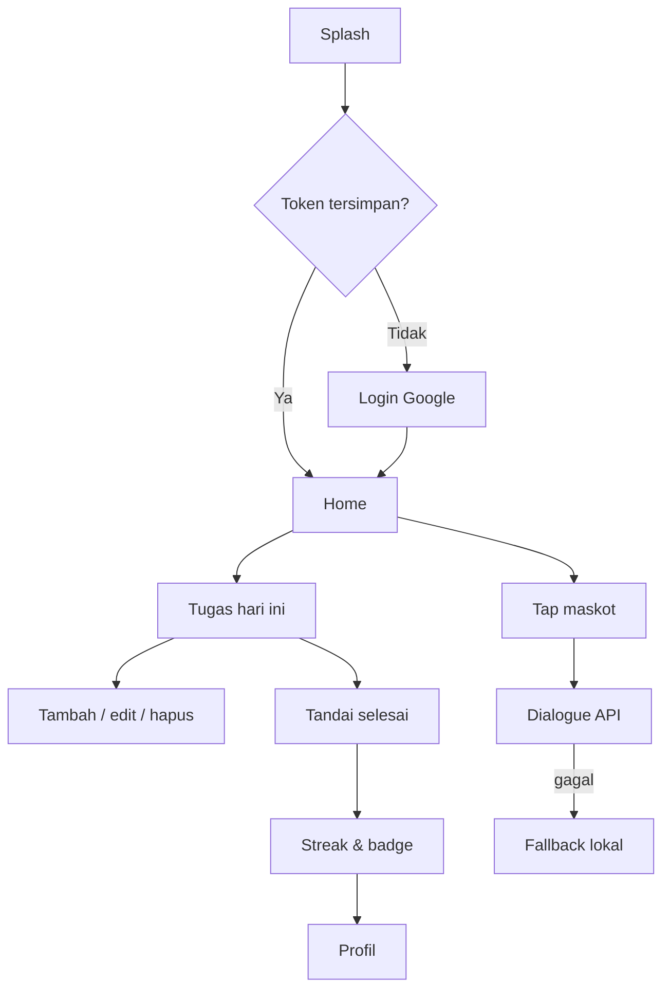

# Product Requirements Document (PRD)

## Kumi MVP v1.0 — Aplikasi Daily Companion Berbasis Mobile

| Atribut | Keterangan |
|---|---|
| **ID Dokumen** | KUMI-PRD-001 |
| **Versi** | 1.0 |
| **Tanggal** | 25 Oktober 2026 |
| **Status** | Draft baseline MVP; siap untuk reviu teknis dan UAT |
| **Pemilik Produk** | Tim Produk Kumi |
| **Target Rilis** | MVP v1.0.0 (demo akademik) |
| **Platform** | Android (utama), iOS (sekunder) |
| **Bahasa Antarmuka** | Indonesia |
| **Menggantikan** | Bagian II pada `.projectmem/reference/01-brd-prd.md` |
| **Dokumen Induk** | `docs/BRD.md` |
| **Dokumen Teknis Terkait** | `.projectmem/reference/02-architecture-deployment.md`, `.projectmem/reference/03-database-erd.md`, `.projectmem/reference/04-api-contract.md`, `.projectmem/reference/05-ui-ux-wireframe.md`, `.projectmem/reference/06-repo-guidelines.md` |

---

## Riwayat Revisi

| Versi | Tanggal | Penulis | Perubahan | Status |
|---|---|---|---|---|
| 1.0 | 25 Okt 2026 | Tim Produk Kumi | Dokumen awal: visi, persona, journey, functional requirements, layar, data/API, NFR, rencana rilis, QA, dan status implementasi | Draft |

## Persetujuan

| Peran | Nama | Tanda Tangan | Tanggal |
|---|---|---|---|
| Product Owner | Tim Kumi |  |  |
| Technical Lead |  |  |  |
| QA Lead |  |  |  |
| Dosen Pengampu |  |  |  |

---

## 1. Ringkasan Produk

### 1.1 Visi Produk

Menjadi pendamping harian yang membuat pengelolaan tugas terasa ringan, hangat, dan layak untuk diulang setiap hari.

### 1.2 Ringkasan

Kumi adalah aplikasi Flutter yang berkomunikasi dengan REST API FastAPI. Pengguna masuk dengan akun Google, mengelola tugas harian, menerima notifikasi lokal, dan berinteraksi dengan maskot rubah bernama Kumi. Backend menyimpan data pada MariaDB dan mengembalikan dialog kontekstual berdasarkan waktu serta status tugas.

MVP mencakup:

- Autentikasi Google dan sesi JWT lokal.
- CRUD tugas dengan tenggat, filter tanggal, dan status.
- Home yang menampilkan prioritas hari ini, progres, dan maskot.
- Notifikasi lokal 15 menit sebelum tenggat.
- Streak dan enam badge pencapaian.
- Profil, edit nama, dan grid pencapaian.
- Dialog maskot berbasis konteks dengan fallback offline.
- Deployment publik melalui Nginx dan HTTPS.

### 1.3 Prinsip Produk

1. **Satu layar, satu tujuan.** Home menjawab “apa hari ini”, Tugas menjawab “apa saja”, Profil menjawab “bagaimana kemajuanku”.
2. **Maskot tidak mengganggu.** Kumi hadir sebagai pendamping, bukan pop-up yang menghalangi alur.
3. **Umpan balik instan.** Setiap aksi memberi respons visual dalam < 300 ms; operasi jaringan memakai indikator yang jelas.
4. **Ramah jaringan buruk.** Kesalahan jaringan ditampilkan sebagai pesan yang dapat dicoba ulang.
5. **Sedikit tetapi bermakna.** Fitur gamifikasi dan maskot harus relevan, bukan dekorasi tanpa dampak.

### 1.4 Ruang Lingkup Rilis

| Aspek | Ketentuan |
|---|---|
| Arsitektur | Client-server |
| Frontend | Flutter (Dart), Material 3 |
| Backend | FastAPI (Python 3.12), SQLAlchemy, Pydantic |
| Basis data | MariaDB 11.4 di produksi; SQLite untuk test lokal |
| Autentikasi | Google Sign-In (ID Token) ditukar dengan JWT lokal HS256 |
| Infrastruktur | VPS, Docker Compose, Nginx reverse proxy, Let’s Encrypt |
| Notifikasi | Lokal, dijadwalkan perangkat; tanpa push server |
| Format API | REST, JSON, prefix `/api/v1` |
| Bahasa | Indonesia |
| Perangkat | Android 7.0+ dan iOS 15+ (mengikuti konfigurasi build aktual) |

---

## 2. Tujuan, Non-Goals, dan Metrik

### 2.1 Tujuan Produk

| Kode | Tujuan | Indikator |
|---|---|---|
| G-01 | Pengguna dapat menyelesaikan alur inti dari login sampai tugas selesai tanpa bantuan | UAT end-to-end lulus |
| G-02 | Pengguna memahami prioritas hari ini dalam < 5 detik | Uji kegunaan task-based |
| G-03 | Pengguna mendapat pengingat yang relevan dan tidak berlebihan | Notifikasi muncul sesuai jadwal; dapat dibatalkan |
| G-04 | Pengguna merasakan kemajuan melalui progres, streak, dan badge | Minimal dua badge dapat didemonstrasikan |
| G-05 | Aplikasi stabil dan aman selama demo | Uptime ≥ 99%; tidak ada akses lintas pengguna |
| G-06 | Proyek dapat dijalankan ulang oleh pihak lain | README dan test lulus dari lingkungan bersih |

### 2.2 Non-Goals

- Menjadi aplikasi produktivitas lengkap dengan proyek, tim, dan kolaborasi.
- Menyediakan chatbot bebas atau asisten berbasis LLM.
- Memprediksi prioritas dengan model Machine Learning aktif.
- Menyinkronkan kalender eksternal atau multi-perangkat secara real-time.
- Menyediakan aplikasi web atau desktop.
- Menyediakan pembayaran, langganan, atau fitur sosial.
- Menyediakan login manual dan pemulihan kata sandi.
- Menyediakan push notification lintas perangkat pada MVP.

### 2.3 Metrik Produk

| Kode | Metrik | Target | Cara Ukur |
|---|---|---|---|
| M-01 | Aktivasi | ≥ 70% pengguna membuat ≥ 1 tugas dalam 24 jam | Query `users` + `tasks` |
| M-02 | Tugas selesai/minggu | ≥ 5 per pengguna aktif | Query `tasks` |
| M-03 | Retensi D2 | ≥ 40% | Perlu event sesi/login |
| M-04 | Interaksi maskot | ≥ 50% sesi | Perlu event tap |
| M-05 | Keberhasilan alur inti | 100% skenario P0 UAT | UAT checklist |
| M-06 | Kualitas teknis | 0 error analyzer; seluruh automated test lulus | CI/log |

---

## 3. Pengguna dan Jobs To Be Done

### 3.1 Persona

| Persona | Demografi | Konteks Penggunaan | Kebutuhan Utama | Anti-Pattern yang Dihindari |
|---|---|---|---|---|
| **Rani** | 20 tahun, mahasiswa semester 4 | Sela kuliah, pagi, malam | Prioritas hari ini cepat terlihat; aplikasi terasa lucu dan ringan | Form panjang, layar kosong tanpa arahan, notifikasi berlebihan |
| **Dimas** | 25 tahun, junior analyst | Pagi sebelum kerja, malam sebelum tidur | Progres dan streak; tugas terpisah dari pekerjaan | Aplikasi terasa seperti dashboard korporat |
| **Pengguna sekunder** | 18–30 tahun, mahasiswa/pekerja muda | Mobilitas tinggi | Konsistensi kebiasaan dan rasa ditemani | Gamifikasi yang terlalu memaksa |

### 3.2 Jobs To Be Done

| Kode | Ketika | Saya ingin | Sehingga |
|---|---|---|---|
| JTBD-01 | Membuka aplikasi di pagi hari | Melihat tugas hari ini dan progres | Saya tahu harus mulai dari mana |
| JTBD-02 | Mempunyai tenggat | Mendapat pengingat sebelum tenggat | Saya tidak melewatkan tugas |
| JTBD-03 | Menyelesaikan tugas | Mendapat apresiasi dan melihat streak | Saya termotivasi untuk kembali besok |
| JTBD-04 | Rencana berubah | Mengubah atau menghapus tugas dengan cepat | Daftar tetap relevan |
| JTBD-05 | Ingin tahu kemajuan | Melihat statistik dan badge | Saya merasa usahanya terlihat |

---

## 4. User Journey

### 4.1 Journey 1 — Pengguna Baru

1. Pengguna membuka aplikasi dan melihat splash.
2. Aplikasi memeriksa token; karena belum ada sesi, pengguna diarahkan ke Login.
3. Pengguna menekan **Lanjutkan dengan Google** dan memilih akun.
4. Aplikasi mengirim ID Token ke backend, menerima JWT, dan menyimpan sesi.
5. Home menampilkan sapaan, maskot, progres kosong, dan empty state.
6. Pengguna menekan **Tambah tugas**, mengisi judul dan tenggat, lalu menyimpan.
7. Tugas muncul di Home dan daftar Tugas; notifikasi dijadwalkan.
8. Pengguna menandai tugas selesai; progres berubah, maskot merayakan, badge pertama dapat muncul.
9. Pengguna membuka Profil untuk melihat streak, total selesai, dan badge.

**Kriteria sukses:** seluruh langkah selesai tanpa error dan tanpa perlu memuat ulang manual.

### 4.2 Journey 2 — Pengguna Harian

1. Aplikasi dibuka; sesi valid; Home langsung tampil.
2. Pengguna melihat progres hari ini dan maksimal tiga tugas berikutnya.
3. Pengguna menyelesaikan satu tugas dari Home.
4. Aplikasi memperbarui progres dan streak; maskot menampilkan dialog `task_done`.
5. Pengguna menutup aplikasi dan kembali keesokan hari.

**Kriteria sukses:** waktu dari membuka aplikasi sampai melihat prioritas < 5 detik pada perangkat kelas menengah.

### 4.3 Journey 3 — Perubahan Rencana

1. Pengguna membuka tab Tugas dan memilih tanggal.
2. Pengguna membuka detail tugas, mengubah judul/deskripsi/tenggat, lalu menyimpan.
3. Daftar menampilkan data terbaru; pengingat lama dibatalkan dan pengingat baru dijadwalkan.
4. Pengguna menghapus tugas lain; konfirmasi muncul; tugas hilang dan notifikasinya dibatalkan.

**Kriteria sukses:** perubahan terlihat tanpa restart; data pengguna lain tidak dapat diakses.

### 4.4 Journey 4 — Gagal Terhubung

1. Pengguna membuka Home saat jaringan tidak tersedia.
2. Aplikasi menampilkan pesan error yang jelas dan tombol **Coba lagi**.
3. Pengguna mengetuk maskot; karena API tidak tersedia, aplikasi menampilkan dialog fallback lokal.
4. Setelah jaringan pulih, pengguna menarik untuk menyegarkan dan data dimuat.

**Kriteria sukses:** aplikasi tidak crash; pengguna memahami langkah berikutnya.



---

## 5. Information Architecture dan Navigasi

### 5.1 Struktur Rute

| Layar | Rute | Tipe | Argumen | Status |
|---|---|---|---|---|
| Splash | `/` | Halaman | — | Terimplementasi |
| Login | `/login` | Halaman | — | Terimplementasi |
| Home | `/home` | Tab | — | Terimplementasi |
| Tugas | `/tasks` | Tab | — | Terimplementasi |
| Profil | `/profile` | Tab | — | Terimplementasi |
| Form tugas | Modal | Bottom sheet | `task?` | Terimplementasi |
| Detail badge | Modal | Bottom sheet | `achievement` | Terimplementasi |

> Catatan: dokumen UI/UX lama menyebut rute `/profile/achievements`. Implementasi aktual menampilkan grid badge di `/profile` dan detailnya sebagai modal. PRD ini mengikuti implementasi aktual; rute terpisah tidak diperlukan untuk MVP.

### 5.2 Aturan Navigasi

1. Status autentikasi `unknown` → Splash.
2. Belum terautentikasi → `/login`.
3. Sudah terautentikasi dan membuka `/` atau `/login` → `/home`.
4. Bottom navigation memiliki tiga tab: Home, Tugas, Profil.
5. Form tugas selalu modal agar konteks daftar tetap terlihat.
6. Sesi kedaluwarsa → hapus sesi → `/login` dengan pesan.
7. Tombol back pada layar utama tidak menampilkan halaman kosong; aplikasi keluar atau kembali ke tab sebelumnya sesuai perilaku platform.

### 5.3 Prinsip Layout

- Padding layar: 20 dp horizontal.
- Target sentuh minimum: 48 dp.
- Radius kartu: 16; tombol: 14; chip: 999.
- Warna utama oranye hangat `#E07A3F`; latar krem `#FFF8F2`.
- Teks utama minimum 14 sp; caption 12 sp hanya untuk metadata.
- Satu aksi utama per layar.

---

## 6. Functional Requirements

### 6.1 Legenda Status

| Simbol | Status | Arti |
|---|---|---|
| ✅ | **Terverifikasi otomatis** | Terimplementasi dan tercakup automated test yang relevan |
| 🟡 | **Terimplementasi, menunggu verifikasi** | Kode tersedia; belum diverifikasi end-to-end pada perangkat/integrasi nyata |
| 🟠 | **Parsial** | Sebagian perilaku ada; terdapat gap yang tercatat |
| ⚪ | **Belum** | Belum diimplementasikan atau di luar MVP |

> Status merepresentasikan kondisi per **25 Oktober 2026**, bukan status UAT final.

### 6.2 Autentikasi

| ID | Requirement | Prioritas | Kriteria Penerimaan | Status |
|---|---|---|---|---|
| **FR-AUTH-01** | Pengguna dapat masuk menggunakan akun Google | Must | **Given** pengguna di Login; **When** menekan tombol Google dan memilih akun; **Then** aplikasi mengirim ID Token ke `POST /api/v1/auth/google`, menyimpan JWT, dan menampilkan Home | 🟡 |
| **FR-AUTH-02** | Sesi tersimpan dapat dipulihkan saat aplikasi dibuka | Must | **Given** secure storage berisi JWT; **When** aplikasi dibuka; **Then** pengguna langsung diarahkan ke Home tanpa login ulang | 🟡 |
| **FR-AUTH-03** | Sesi kedaluwarsa ditangani dengan aman | Must | **Given** API mengembalikan `401 TOKEN_EXPIRED`; **When** pengguna mengakses data; **Then** sesi dihapus dan pengguna diarahkan ke Login dengan pesan “Sesi berakhir, silakan masuk kembali.” | 🟡 |
| **FR-AUTH-04** | Pengguna dapat keluar | Must | **Given** pengguna di Profil; **When** memilih Keluar dan mengonfirmasi; **Then** JWT, nama tersimpan, dan sesi Google dihapus; aplikasi kembali ke Login | 🟡 |
| **FR-AUTH-05** | Pengguna baru dibuat otomatis | Must | **Given** ID Token valid dengan `google_id` baru; **When** login; **Then** baris `users` dibuat dengan email, nama, dan foto dari Google; `is_new_user = true` | 🟡 |
| **FR-AUTH-06** | ID Token tidak valid ditolak tanpa crash | Must | **Given** token invalid/kedaluwarsa; **When** dikirim; **Then** API mengembalikan `401 INVALID_GOOGLE_TOKEN`; UI menampilkan pesan yang dapat dipahami | 🟡 |
| **FR-AUTH-07** | Email Google belum terverifikasi ditolak | Should | **Given** klaim `email_verified = false`; **When** login; **Then** API mengembalikan `401 EMAIL_NOT_VERIFIED` dan UI tidak membuat sesi | 🟡 |

**Catatan implementasi:** login Google belum diuji dengan kredensial nyata. Tidak ada automated test untuk jalur sukses login karena memerlukan token Google asli; test saat ini memverifikasi penolakan token invalid dan siklus JWT lokal.

### 6.3 Home

| ID | Requirement | Prioritas | Kriteria Penerimaan | Status |
|---|---|---|---|---|
| **FR-HOME-01** | Home menampilkan sapaan personal dan tanggal | Should | **Given** profil tersedia; **When** Home dibuka; **Then** nama depan dan tanggal lokal berbahasa Indonesia tampil | 🟡 |
| **FR-HOME-02** | Home menampilkan progres tugas hari ini | Must | **Given** pengguna memiliki tugas hari ini; **When** data dimuat; **Then** tampil `selesai / total` dan progress bar; jika total 0, tampil pesan kosong | 🟡 |
| **FR-HOME-03** | Home menampilkan maksimal tiga tugas berikutnya | Must | **Given** ada tugas belum selesai; **When** Home dimuat; **Then** tiga tugas dengan tenggat terdekat ditampilkan berurutan | 🟡 |
| **FR-HOME-04** | Pengguna dapat menyelesaikan tugas dari Home | Must | **Given** tugas belum selesai; **When** pengguna menekan tombol centang; **Then** status berubah, progres diperbarui, dan umpan balik maskot muncul | 🟡 |
| **FR-HOME-05** | Home menampilkan maskot dan speech bubble | Must | **Given** pengguna di Home; **When** maskot diketuk; **Then** dialog kontekstual tampil pada bubble tanpa menutupi konten utama | 🟡 |
| **FR-HOME-06** | Home mendukung refresh dan error state | Should | **Given** terjadi error jaringan; **When** Home dimuat; **Then** pesan error dan tombol **Coba lagi** tampil; pull-to-refresh memuat ulang data | 🟡 |
| **FR-HOME-07** | Home menyediakan jalan pintas navigasi | Should | **Given** pengguna di Home; **When** menekan avatar atau **Lihat semua**; **Then** diarahkan ke Profil atau Tugas | 🟡 |

### 6.4 Manajemen Tugas

| ID | Requirement | Prioritas | Kriteria Penerimaan | Status |
|---|---|---|---|---|
| **FR-TASK-01** | Pengguna dapat melihat daftar tugas berdasarkan tanggal | Must | **Given** pengguna di tab Tugas; **When** memilih tanggal atau menggeser hari; **Then** hanya tugas pada tanggal lokal tersebut yang tampil, dikelompokkan belum selesai dan selesai | 🟠 |
| **FR-TASK-02** | Pengguna dapat memfilter status | Must | **Given** daftar tugas; **When** memilih Semua/Belum/Selesai; **Then** daftar dimuat sesuai filter dari server | 🟡 |
| **FR-TASK-03** | Pengguna dapat membuat tugas | Must | **Given** form terbuka; **When** mengisi judul 1–150 karakter, deskripsi ≤ 1000 karakter, dan tenggat masa depan lalu menyimpan; **Then** `POST /api/v1/tasks` berhasil, tugas muncul, dan pengingat dijadwalkan | 🟡 |
| **FR-TASK-04** | Pengguna dapat mengubah tugas | Must | **Given** tugas milik pengguna; **When** mengubah judul/deskripsi/tenggat lalu menyimpan; **Then** `PUT /api/v1/tasks/{id}` berhasil, daftar diperbarui, dan pengingat dijadwalkan ulang | 🟠 |
| **FR-TASK-05** | Pengguna dapat menghapus tugas | Must | **Given** tugas milik pengguna; **When** memilih Hapus dan mengonfirmasi; **Then** `DELETE /api/v1/tasks/{id}` mengembalikan `204`, item hilang, pengingat dibatalkan, dan streak dihitung ulang bila perlu | 🟡 |
| **FR-TASK-06** | Pengguna dapat menandai tugas selesai/belum selesai | Must | **Given** tugas belum selesai; **When** menekan centang; **Then** `is_completed = true`, `completed_at` terisi, dan respons memuat gamifikasi; menekan lagi mengembalikan status dan mengosongkan `completed_at` | 🟡 |
| **FR-TASK-07** | Tugas menampilkan indikator waktu | Should | **Given** tugas memiliki tenggat; **When** ditampilkan; **Then** status terlambat berwarna merah, segera (< 2 jam) berwarna kuning, selesai berlatar redup dan judul dicoret | 🟡 |
| **FR-TASK-08** | Pengguna dapat memakai gesture geser | Could | **Given** tugas di daftar; **When** menggeser ke kanan; **Then** status selesai dibalik; **When** menggeser ke kiri; **Then** dialog konfirmasi hapus muncul | 🟡 |
| **FR-TASK-09** | Daftar memiliki state loading, kosong, dan error | Must | **Given** data sedang dimuat/tidak ada/error; **When** layar dibuka; **Then** tampil indikator, empty state dengan CTA tambah, atau error dengan tombol coba lagi | 🟡 |

**Catatan implementasi penting:**

- **FR-TASK-01 (Parsial):** filter `date` dikirim sebagai tanggal lokal, tetapi backend membandingkannya dengan rentang tanggal UTC. Pada zona waktu Indonesia (UTC+7), tugas pukul 00.00–06.59 lokal dapat tidak muncul, sedangkan tugas dini hari tanggal berikutnya dapat ikut muncul. Perbaikan P0 ada di Lampiran B.
- **FR-TASK-04 (Parsial):** backend menolak `due_time` lampau saat create, tetapi tidak menolak saat update. Perilaku create, update, dan PRD harus diselaraskan.

### 6.5 Profil

| ID | Requirement | Prioritas | Kriteria Penerimaan | Status |
|---|---|---|---|---|
| **FR-PROF-01** | Pengguna dapat melihat profil dan statistik | Must | **Given** pengguna login; **When** membuka Profil; **Then** tampil foto/avatar, nama, email, streak, dan total tugas selesai | 🟡 |
| **FR-PROF-02** | Pengguna dapat mengubah nama tampilan | Must | **Given** pengguna membuka edit nama; **When** mengirim nama 1–100 karakter yang tidak hanya spasi; **Then** `PUT /api/v1/user/profile` berhasil dan nama diperbarui di Home/Profil | 🟡 |
| **FR-PROF-03** | Nama hasil edit tidak ditimpa Google | Must | **Given** pengguna pernah mengubah nama; **When** login Google lagi; **Then** nama hasil edit tetap dipertahankan, sementara email/foto diperbarui | 🟡 |
| **FR-PROF-04** | Pengguna dapat melihat grid pencapaian | Must | **Given** data badge tersedia; **When** Profil dibuka; **Then** badge diraih tampil berwarna, badge belum tampil redup dengan ikon kunci, dan rasio diraih/total terlihat | 🟡 |
| **FR-PROF-05** | Pengguna dapat melihat detail badge | Should | **Given** pengguna menekan badge; **When** modal terbuka; **Then** nama, deskripsi, status, dan tanggal diraih (jika ada) tampil | 🟡 |
| **FR-PROF-06** | Profil menampilkan fallback avatar | Should | **Given** `picture_url` kosong atau gagal dimuat; **When** avatar dirender; **Then** inisial nama ditampilkan | 🟡 |

### 6.6 Gamifikasi

| ID | Requirement | Prioritas | Kriteria Penerimaan | Status |
|---|---|---|---|---|
| **FR-GAM-01** | Streak dihitung dari hari penyelesaian tugas | Must | **Given** pengguna menyelesaikan ≥ 1 tugas pada hari berturut-turut; **When** status berubah; **Then** streak bertambah; beberapa tugas pada hari yang sama dihitung satu hari; jeda satu hari mereset streak | ✅ |
| **FR-GAM-02** | Streak ditampilkan dan diperbarui | Must | **Given** penyelesaian tugas berhasil; **When** respons gamifikasi diterima; **Then** nilai streak di Home/Profil diperbarui tanpa reload manual | 🟡 |
| **FR-GAM-03** | Badge diberikan saat ambang tercapai | Must | **Given** total tugas selesai atau streak mencapai ambang; **When** tugas diselesaikan; **Then** badge baru dicatat di `user_achievements` dan dikembalikan pada respons | ✅ |
| **FR-GAM-04** | Badge tidak duplikat | Must | **Given** badge sudah dimiliki; **When** kondisi terpenuhi kembali; **Then** tidak ada baris baru karena constraint `UNIQUE(user_id, achievement_id)` | ✅ |
| **FR-GAM-05** | Badge baru dirayakan | Should | **Given** badge baru diperoleh; **When** respons sukses; **Then** bottom sheet menampilkan nama dan deskripsi badge | 🟡 |
| **FR-GAM-06** | Enam badge MVP tersedia | Must | **Given** seed dijalankan; **When** pengguna membuka Profil; **Then** enam badge tampil dengan kriteria yang benar | 🟠 |
| **FR-GAM-07** | Badge streak dapat dievaluasi saat profil dimuat | Should | **Given** pengguna mencapai streak 7 hari; **When** membuka Profil; **Then** badge `streak_7` diberikan tanpa harus menyelesaikan tugas baru | ⚪ |

**Daftar badge MVP:**

| Kode | Nama | Kriteria |
|---|---|---|
| `first_steps` | Langkah Pertama | Total 1 tugas selesai |
| `task_10` | Produktif | Total 10 tugas selesai |
| `task_50` | Sangat Produktif | Total 50 tugas selesai |
| `streak_3` | Tiga Hari | Streak 3 hari |
| `streak_7` | Seminggu Konsisten | Streak 7 hari |
| `streak_30` | Sebulan Penuh | Streak 30 hari |

**Catatan:** `FR-GAM-06` parsial karena seed tidak dijalankan otomatis pada deployment baru; database lokal saat ini kosong. `FR-GAM-07` belum diimplementasikan; evaluasi badge hanya terjadi saat penyelesaian tugas.

### 6.7 Maskot Kumi

| ID | Requirement | Prioritas | Kriteria Penerimaan | Status |
|---|---|---|---|---|
| **FR-KUMI-01** | Maskot hadir di Home | Must | **Given** pengguna di Home; **When** layar dirender; **Then** maskot tampil pada kartu khusus dengan animasi idle yang halus | 🟡 |
| **FR-KUMI-02** | Tap maskot menampilkan dialog dari backend | Must | **Given** pengguna mengetuk maskot; **When** API tersedia; **Then** `GET /api/v1/kumi/dialog?context=...` dipanggil dan teks tampil pada speech bubble | 🟡 |
| **FR-KUMI-03** | Konteks dialog ditentukan dari waktu dan status | Must | **Given** pukul 05.00–11.59 / 12.00–17.59 / 18.00–04.59; **When** maskot diketuk; **Then** konteks `morning` / `afternoon` / `night`; jika tidak ada tugas gunakan `idle` | 🟡 |
| **FR-KUMI-04** | Dialog tidak langsung berulang | Should | **Given** bubble menampilkan dialog; **When** maskot diketuk lagi dan alternatif tersedia; **Then** `exclude_id` mencegah dialog yang sama tampil berturut-turut | 🟡 |
| **FR-KUMI-05** | Ada fallback saat API gagal | Must | **Given** backend tidak dapat dihubungi; **When** maskot diketuk; **Then** satu dialog lokal tampil dan tidak ada error mentah | 🟡 |
| **FR-KUMI-06** | Penyelesaian tugas memicu perayaan | Must | **Given** pengguna menandai tugas selesai; **When** respons sukses; **Then** maskot berganti ke mood senang maksimal 1,6 detik lalu menampilkan dialog `task_done` | 🟠 |
| **FR-KUMI-07** | Reduce motion dihormati | Should | **Given** pengaturan animasi sistem dinonaktifkan; **When** maskot dirender/diketuk; **Then** animasi gerak dihentikan dan diganti transisi minimal | 🟠 |
| **FR-KUMI-08** | Speech bubble ringkas | Should | **Given** teks dialog panjang; **When** bubble tampil; **Then** maksimal tiga baris dengan ellipsis dan tetap dapat dibaca | 🟡 |

**Catatan:** perayaan saat ini berupa perubahan mood dan bubble, belum mencakup koreografi lompat, scale, dan sparkle seperti yang dijelaskan pada `.projectmem/reference/05-ui-ux-wireframe.md`. Reduce motion baru diterapkan pada animasi idle/tap maskot, belum pada keseluruhan alur perayaan.

### 6.8 Notifikasi Lokal

| ID | Requirement | Prioritas | Kriteria Penerimaan | Status |
|---|---|---|---|---|
| **FR-NOTIF-01** | Aplikasi meminta izin notifikasi | Must | **Given** pengguna pertama kali membuka tab Tugas; **When** izin belum diberikan; **Then** aplikasi meminta izin Android 13+/iOS; jika ditolak, aplikasi tetap berfungsi dan memberi informasi | 🟠 |
| **FR-NOTIF-02** | Pengingat dijadwalkan 15 menit sebelum tenggat | Must | **Given** tugas dengan tenggat masa depan; **When** tugas dibuat/diubah; **Then** notifikasi lokal dijadwalkan 15 menit sebelum tenggat | 🟡 |
| **FR-NOTIF-03** | Pengingat dibatalkan saat tugas selesai/dihapus | Must | **Given** tugas memiliki pengingat; **When** tugas diselesaikan atau dihapus; **Then** notifikasi terkait dibatalkan | 🟡 |
| **FR-NOTIF-04** | Tenggat lampau tidak dijadwalkan | Must | **Given** waktu jadwal pengingat sudah lewat; **When** tugas disimpan; **Then** tidak ada notifikasi baru dibuat | 🟡 |
| **FR-NOTIF-05** | Pengingat dijadwalkan ulang setelah aplikasi dibuka kembali | Should | **Given** pengguna memiliki tugas mendatang; **When** aplikasi dibuka setelah restart; **Then** pengingat yang hilang dijadwalkan ulang | ⚪ |
| **FR-NOTIF-06** | Pengguna dapat memilih waktu pengingat | Could | **Given** pengguna membuat tugas; **When** memilih opsi 0/15/30 menit; **Then** pengingat mengikuti pilihan tersebut | ⚪ |
| **FR-NOTIF-07** | Tap notifikasi membuka konteks tugas | Could | **Given** notifikasi muncul; **When** pengguna mengetuk; **Then** aplikasi membuka Home/Tugas dengan konteks tugas terkait | ⚪ |

**Catatan:** implementasi saat ini memakai pengingat tetap 15 menit dan mode penjadwalan Android `inexactAllowWhileIdle`. Tidak ada mekanisme penjadwalan ulang saat startup, sehingga pengingat dapat hilang setelah reboot atau pembersihan sistem.

### 6.9 Platform, Sistem, dan Operasi

| ID | Requirement | Prioritas | Kriteria Penerimaan | Status |
|---|---|---|---|---|
| **FR-SYS-01** | API memerlukan autentikasi dan mengisolasi data per pengguna | Must | **Given** request tanpa token; **When** mengakses endpoint terproteksi; **Then** `401`; **Given** resource milik pengguna lain; **Then** `404` | ✅ |
| **FR-SYS-02** | Error API memakai kontrak konsisten | Must | **Given** terjadi kesalahan; **When** respons dikirim; **Then** body memuat `detail.code`, `detail.message`, dan `detail.fields` bila validasi | ✅ |
| **FR-SYS-03** | Health check tersedia | Must | **Given** API berjalan; **When** `GET /health`; **Then** status, database, versi, dan waktu dikembalikan; DB gagal → `503` | ✅ |
| **FR-SYS-04** | CORS dapat dikonfigurasi | Must | **Given** origin diizinkan; **When** preflight `OPTIONS`; **Then** header CORS sesuai; origin liar ditolak | 🟡 |
| **FR-SYS-05** | Seed data idempoten | Must | **Given** database kosong; **When** seed dijalankan; **Then** enam badge dan 13 dialog dibuat tanpa duplikasi saat dijalankan ulang | 🟠 |
| **FR-SYS-06** | Aplikasi dapat diakses publik melalui HTTPS | Must | **Given** VPS dan domain aktif; **When** membuka `https://api.<domain>/health`; **Then** TLS valid, HTTP dialihkan ke HTTPS, dan API merespons | ⚪ |
| **FR-SYS-07** | Observabilitas dasar tersedia | Should | **Given** request masuk; **When** terjadi error; **Then** log memuat waktu, level, endpoint, status, dan request ID tanpa data sensitif | ⚪ |
| **FR-SYS-08** | Perubahan skema dapat dimigrasikan | Should | **Given** skema berubah; **When** deploy; **Then** migrasi versi dapat dijalankan tanpa menghapus data | ⚪ |
| **FR-SYS-09** | CI memeriksa kualitas | Should | **Given** pull request; **When** CI berjalan; **Then** lint, test backend, analyze, dan test Flutter wajib lulus | ⚪ |
| **FR-SYS-10** | Dokumentasi operasional lengkap | Must | **Given** pengembang baru; **When** mengikuti README; **Then** aplikasi dan API dapat dijalankan dari nol | 🟠 |
| **FR-SYS-11** | Endpoint auth memiliki rate limit | Should | **Given** percobaan login berlebihan; **When** melewati batas; **Then** `429` dan pesan yang sesuai | 🟠 |
| **FR-SYS-12** | Backup dan restore terdokumentasi dan diuji | Should | **Given** data produksi; **When** backup dijalankan; **Then** dump dapat dipulihkan ke database bersih | 🟠 |
| **FR-SYS-13** | Metrik inti terinstrumentasi | Should | **Given** pengguna membuka sesi/mengetuk maskot; **When** event terjadi; **Then** event tercatat cukup untuk menghitung retensi dan engagement | ⚪ |

**Catatan:** `FR-SYS-11` parsial karena konfigurasi Nginx memakai `limit_req zone=auth`, tetapi definisi zone tidak disertakan dalam file konfigurasi yang disediakan dan harus ditambahkan manual di `nginx.conf`. Selain itu, `limit_req_status` tidak diset, sehingga respons default Nginx adalah `503`, bukan `429` seperti pada kontrak API. `FR-SYS-05` bergantung pada eksekusi `python -m app.seed`; container tidak menjalankannya otomatis.

---

## 7. Spesifikasi Layar

### 7.1 Splash

| Aspek | Spesifikasi |
|---|---|
| **Tujuan** | Memeriksa sesi dan memberi transisi merek |
| **Rute** | `/` |
| **Komponen** | Logo/maskot, teks “KUMI”, tagline “Teman kecil untuk harimu”, indikator loading |
| **Perilaku** | Menunggu minimal 1,2 detik; memulihkan token; mengarahkan ke Home atau Login |
| **State** | Loading; tidak ada error yang ditampilkan ke pengguna |
| **Catatan** | Splash saat ini memakai emoji rubah, bukan aset maskot final. Perlu diganti sebelum rilis visual final |

### 7.2 Login

| Aspek | Spesifikasi |
|---|---|
| **Tujuan** | Masuk dengan Google tanpa membuat kata sandi |
| **Rute** | `/login` |
| **Komponen** | Ilustrasi rubah, judul “Halo, aku Kumi!”, subjudul, tombol **Lanjutkan dengan Google**, teks persetujuan |
| **Aksi** | Tombol memicu Google Sign-In; saat proses, tombol menampilkan spinner dan dinonaktifkan |
| **Error** | Snackbar dengan pesan dari API atau pesan umum “Gagal masuk. Coba lagi.” |
| **Aturan** | Tidak ada form email/kata sandi; pengguna yang sudah login tidak dapat kembali ke layar ini |
| **Catatan** | Teks “Ketentuan Layanan” belum memiliki tautan; perlu ditinjau sebelum rilis publik |

### 7.3 Home

| Aspek | Spesifikasi |
|---|---|
| **Tujuan** | Menjawab “apa yang harus dikerjakan hari ini” |
| **Rute** | `/home` |
| **Komponen** | Sapaan + tanggal; avatar; kartu maskot + bubble; progress bar; daftar maksimal tiga tugas berikutnya; tautan **Lihat semua** |
| **Aksi** | Tap maskot; centang tugas; buka Profil; buka Tugas; pull-to-refresh |
| **State** | Loading awal; empty state; error dengan retry; state perayaan |
| **Aturan** | Hanya tugas hari ini; progress dihitung dari seluruh tugas hari ini; daftar berikutnya hanya yang belum selesai |

### 7.4 Tugas

| Aspek | Spesifikasi |
|---|---|
| **Tujuan** | Melihat dan mengelola seluruh tugas pada tanggal tertentu |
| **Rute** | `/tasks` |
| **Komponen** | Judul; navigator tanggal (prev/next/picker); chip filter Semua/Belum/Selesai; section header; task card; FAB tambah |
| **Aksi** | Pilih tanggal; filter; buka form; edit; hapus; toggle; swipe kanan selesai; swipe kiri hapus |
| **State** | Loading; empty dengan CTA; error dengan retry; daftar terisi |
| **Aturan** | Pengurutan `due_time` naik; section belum selesai di atas; konfirmasi wajib untuk hapus |

### 7.5 Form Tugas (Modal)

| Aspek | Spesifikasi |
|---|---|
| **Tujuan** | Membuat atau mengubah tugas |
| **Tipe** | `ModalBottomSheet` dengan `isScrollControlled` |
| **Field** | Judul (wajib, 1–150); deskripsi (opsional, ≤ 1000); tenggat (wajib, date + time picker) |
| **Validasi** | Judul kosong ditolak; panjang melebihi batas ditolak; tenggat lampau diberi peringatan |
| **Aksi** | Simpan; batal dengan menutup sheet |
| **State** | Saving dengan spinner; error umum; error field dari server (belum dipetakan ke field individual) |
| **Aturan** | Setelah simpan, daftar dimuat ulang; pengingat dijadwalkan; modal ditutup hanya jika berhasil |

### 7.6 Profil

| Aspek | Spesifikasi |
|---|---|
| **Tujuan** | Menjawab “bagaimana kemajuanku” |
| **Rute** | `/profile` |
| **Komponen** | Avatar; nama; email; tombol edit nama; kartu streak; kartu total selesai; grid badge; tombol keluar |
| **Aksi** | Edit nama; buka detail badge; keluar |
| **State** | Loading; error dengan retry; data; empty badge |
| **Aturan** | Edit nama memakai dialog; nama kosong ditolak; keluar meminta konfirmasi |

### 7.7 Detail Badge (Modal)

| Aspek | Spesifikasi |
|---|---|
| **Tujuan** | Menjelaskan pencapaian dan statusnya |
| **Komponen** | Ikon badge/lock; nama; deskripsi; tanggal diraih bila ada |
| **State** | Diraih vs belum diraih |
| **Aturan** | Badge belum diraih tetap dapat dibuka untuk melihat kriteria |

### 7.8 State Global

| State | Perilaku |
|---|---|
| **Loading** | Spinner pada konten; tombol aksi disabled saat proses |
| **Empty** | Ikon, judul, pesan, dan CTA bila relevan |
| **Error jaringan** | Pesan ramah + tombol **Coba lagi**; tidak menampilkan stack trace |
| **Sesi berakhir** | Hapus sesi; arahkan ke Login; tampilkan pesan |
| **Offline maskot** | Dialog fallback lokal; tidak ada error mentah |
| **Form error** | Pesan di bawah field atau di atas tombol simpan |
| **Konfirmasi destruktif** | Dialog konfirmasi untuk hapus tugas dan keluar |

---

## 8. Data dan API

### 8.1 Model Domain

| Entitas | Field Utama | Relasi | Catatan |
|---|---|---|---|
| `users` | `id`, `google_id`, `email`, `name`, `picture_url`, `current_streak`, `last_completed_date`, `created_at`, `updated_at` | 1:N ke `tasks`; 1:N ke `user_achievements` | `google_id` dan `email` unik; nama dapat diedit |
| `tasks` | `id`, `user_id`, `title`, `description`, `due_time`, `is_completed`, `completed_at`, `created_at`, `updated_at` | N:1 ke `users` | Hard delete pada MVP; `completed_at` menjadi dasar streak |
| `achievements` | `id`, `code`, `name`, `description`, `icon`, `criteria_type`, `criteria_value`, `created_at` | 1:N ke `user_achievements` | Master data; kriteria `total_completed` atau `streak` |
| `user_achievements` | `id`, `user_id`, `achievement_id`, `earned_at` | N:1 ke `users` dan `achievements` | Unik per pasangan pengguna–badge |
| `kumi_dialogs` | `id`, `context`, `text`, `is_active`, `created_at` | Standalone | Konteks: `morning`, `afternoon`, `night`, `task_done`, `idle` |

### 8.2 Endpoint API

| # | Method | Path | Auth | Deskripsi | Status |
|---|---|---|---|---|---|
| 1 | POST | `/api/v1/auth/google` | Tidak | Tukar ID Token Google dengan JWT lokal | 🟡 |
| 2 | GET | `/api/v1/user/profile` | Ya | Profil + statistik | ✅ |
| 3 | PUT | `/api/v1/user/profile` | Ya | Ubah nama tampilan | ✅ |
| 4 | GET | `/api/v1/tasks` | Ya | Daftar tugas dengan filter tanggal/status/paginasi | 🟡 |
| 5 | POST | `/api/v1/tasks` | Ya | Buat tugas | ✅ |
| 6 | GET | `/api/v1/tasks/{id}` | Ya | Detail tugas | ✅ |
| 7 | PUT | `/api/v1/tasks/{id}` | Ya | Ubah tugas | 🟡 |
| 8 | DELETE | `/api/v1/tasks/{id}` | Ya | Hapus tugas | ✅ |
| 9 | PATCH | `/api/v1/tasks/{id}/complete` | Ya | Toggle status selesai + gamifikasi | ✅ |
| 10 | GET | `/api/v1/kumi/dialog` | Ya | Dialog maskot sesuai konteks | ✅ |
| 11 | GET | `/api/v1/achievements` | Ya | Daftar badge + status diraih | ✅ |
| 12 | GET | `/health` | Tidak | Health check API + DB | ✅ |

### 8.3 Alur Autentikasi

```text
Flutter ── Google Sign-In ──> Google Identity
Flutter <── ID Token ──────── Google Identity
Flutter ── POST /auth/google {id_token} ──> FastAPI
FastAPI ── verifikasi signature/aud/iss/exp ──> Google
FastAPI ── upsert user ──> MariaDB
FastAPI <── user ────────── MariaDB
FastAPI ── JWT lokal HS256 ──> Flutter
Flutter ── simpan JWT di secure storage
Flutter ── Authorization: Bearer <jwt> ──> FastAPI
```

Aturan verifikasi:

| Pemeriksaan | Aturan |
|---|---|
| Signature | Divalidasi terhadap sertifikat publik Google |
| `aud` | Harus sama dengan `GOOGLE_CLIENT_ID` backend |
| `iss` | `accounts.google.com` atau `https://accounts.google.com` |
| `exp` | Belum kedaluwarsa |
| `email_verified` | Harus `true` |

JWT lokal:

- Algoritma HS256; klaim `sub` (user id), `iat`, `exp`.
- Umur default 7 hari; tidak ada refresh token pada MVP.
- Disimpan di `flutter_secure_storage`.
- Dikirim pada header `Authorization: Bearer <token>`.

### 8.4 Kontrak Error

```json
{
  "detail": {
    "code": "VALIDATION_ERROR",
    "message": "Data tidak valid.",
    "fields": {
      "title": "Judul wajib diisi"
    }
  }
}
```

| HTTP | Kode | Kapan |
|---|---|---|
| 400 | `BAD_REQUEST` | Permintaan tidak dapat diproses |
| 401 | `INVALID_GOOGLE_TOKEN` | ID Token Google gagal diverifikasi |
| 401 | `EMAIL_NOT_VERIFIED` | Email Google belum terverifikasi |
| 401 | `TOKEN_EXPIRED` | JWT lokal kedaluwarsa |
| 401 | `UNAUTHORIZED` | Header Authorization hilang/tidak valid |
| 404 | `NOT_FOUND` | Resource tidak ada atau bukan milik pengguna |
| 422 | `VALIDATION_ERROR` | Body/parameter gagal validasi |
| 429 | `RATE_LIMITED` | Melebihi batas permintaan |
| 500 | `INTERNAL_ERROR` | Kesalahan tak terduga |

### 8.5 Waktu dan Zona Waktu

| Aspek | Ketentuan |
|---|---|
| Penyimpanan | Semua timestamp disimpan UTC |
| Serialisasi | ISO 8601 dengan sufiks `Z` |
| Tampilan | Dikonversi ke zona waktu lokal perangkat |
| Filter tanggal | **Seharusnya** menggunakan batas hari lokal pengguna yang dikonversi ke rentang UTC |
| Streak | **Seharusnya** mengikuti hari kalender lokal pengguna |
| Kondisi saat ini | Backend memakai batas hari UTC; filter tanggal dan streak dapat berbeda dari hari lokal pengguna |

> Gap zona waktu adalah defect P0 karena memengaruhi daftar tugas harian dan streak, tertutama pada UTC+7.

### 8.6 Paginasi

| Parameter | Default | Maksimum | Catatan |
|---|---|---|---|
| `limit` | 50 | 100 | Klien saat ini meminta 100 |
| `offset` | 0 | — | Berbasis offset, bukan cursor |

Respons daftar:

```json
{
  "items": [],
  "total": 0
}
```

---

## 9. Non-Functional Requirements

| ID | Kategori | Persyaratan | Verifikasi |
|---|---|---|---|
| **NFR-01** | Performa API | p95 < 500 ms untuk operasi CRUD pada dataset demo | Log akses/load test |
| **NFR-02** | Performa aplikasi | Cold start < 3 detik pada perangkat kelas menengah; animasi 60 fps | Profiling perangkat |
| **NFR-03** | Responsivitas UI | Umpan balik visual < 300 ms; operasi jaringan memakai indikator | UAT |
| **NFR-04** | Ketersediaan | Uptime API ≥ 99% selama periode demo; health check tersedia | Monitoring manual |
| **NFR-05** | Keamanan | HTTPS/TLS 1.2+; JWT wajib; verifikasi Google; secret hanya di environment; rate limit auth | Audit konfigurasi |
| **NFR-06** | Privasi | Hanya nama, email, foto, dan data tugas; tidak ada kata sandi; isolasi per pengguna | Review data + test |
| **NFR-07** | Usability | Tambah tugas ≤ 3 interaksi dari Home; target sentuh ≥ 48 dp; teks utama ≥ 14 sp | UAT |
| **NFR-08** | Aksesibilitas | Kontras WCAG AA; label semantik; reduce motion; text scale hingga 1.3× tanpa overflow | Audit aksesibilitas |
| **NFR-09** | Kompatibilitas | Android 7.0+ (mengikuti `minSdk` Flutter); iOS 15+ (deployment target aktual); orientasi portrait | Build matrix |
| **NFR-10** | Lokalisasi | Seluruh teks utama berbahasa Indonesia; format tanggal `id_ID` | Review UI |
| **NFR-11** | Observabilitas | Log terstruktur, request ID, health check; tanpa PII di log | Review log |
| **NFR-12** | Maintainability | `flutter analyze` bersih; lint backend; test lulus; dokumentasi diperbarui | CI/review |
| **NFR-13** | Durabilitas | Backup MariaDB terjadwal/manual; restore diuji; migrasi skema terkontrol | Drill restore |
| **NFR-14** | Skalabilitas | Mendukung 50 pengguna demo dan 1.000 tugas tanpa degradasi berarti | Load test ringan |
| **NFR-15** | Offline | Operasi CRUD membutuhkan jaringan; maskot memiliki fallback lokal; error jelas | UAT offline |
| **NFR-16** | Baterai/Notifikasi | Notifikasi lokal tidak memakai polling; mode inexact dapat diterima | Review implementasi |

---

## 10. Analytics dan Pengukuran

### 10.1 Prinsip

- Tidak ada SDK analitik pihak ketiga pada MVP.
- Metrik dihitung dari basis data dan log server.
- Data yang dikumpulkan harus minimal dan tidak memuat isi tugas pada log.
- Setiap metrik harus memiliki definisi dan query yang dapat diaudit.

### 10.2 Metrik dan Sumber

| Metrik | Definisi | Sumber | Status |
|---|---|---|---|
| Pengguna terdaftar | `COUNT(*)` pada `users` | Basis data | Tersedia |
| Aktivasi | Pengguna dengan tugas pertama ≤ 24 jam setelah registrasi | `users.created_at`, `tasks.created_at` | Tersedia |
| Tugas selesai/minggu | Rata-rata tugas selesai per pengguna aktif | `tasks` | Tersedia |
| Retensi D2 | Pengguna yang kembali pada hari ke-2 | Event login/sesi | **Belum tersedia** |
| Interaksi maskot | Rasio sesi dengan tap maskot | Event tap | **Belum tersedia** |
| Completion rate | Tugas selesai / total tugas | `tasks` | Tersedia |
| Uptime | Rasio health check sehat | Log monitoring | Manual |
| p95 latency | Persentil 95 waktu respons | Log akses | Manual |

### 10.3 Query Referensi

```sql
-- Pengguna terdaftar
SELECT COUNT(*) FROM users;

-- Aktivasi: tugas pertama dalam 24 jam
SELECT COUNT(DISTINCT u.id)
FROM users u
JOIN tasks t ON t.user_id = u.id
WHERE t.created_at <= u.created_at + INTERVAL 1 DAY;

-- Tugas selesai per minggu
SELECT DATE_FORMAT(completed_at, '%x-%v') AS week, COUNT(*) AS completed
FROM tasks
WHERE is_completed = 1
GROUP BY week
ORDER BY week DESC;

-- Completion rate per pengguna
SELECT user_id,
       SUM(is_completed) / COUNT(*) AS completion_rate
FROM tasks
GROUP BY user_id;
```

### 10.4 Gap Instrumentasi

Skema saat ini belum menyimpan:

- Waktu login terakhir atau event sesi.
- Event tap maskot.
- Event pembukaan layar.
- Sumber akuisisi pengguna.

Untuk memenuhi KPI retensi dan engagement maskot, diperlukan salah satu dari:

1. Tabel `analytics_events` append-only dengan event minimal (`user_id`, `event_name`, `occurred_at`, `metadata`), atau
2. Penambahan `users.last_seen_at` dan pencatatan event maskot pada log terstruktur.

Keputusan instrumentasi harus mempertimbangkan privasi dan tidak boleh mencatat isi tugas.

---

## 11. Error Handling dan Edge Cases

| Skenario | Perilaku yang Diharapkan | Status |
|---|---|---|
| ID Token Google invalid | `401 INVALID_GOOGLE_TOKEN`; pesan ramah; tidak ada sesi dibuat | 🟡 |
| Email Google belum terverifikasi | `401 EMAIL_NOT_VERIFIED`; pengguna diminta memverifikasi email | 🟡 |
| JWT kedaluwarsa | Hapus sesi; arahkan ke Login; pesan “Sesi berakhir” | 🟡 |
| Judul tugas kosong | Validasi klien dan server; form tidak dikirim | 🟡 |
| Judul hanya spasi | Ditolak setelah `trim` | 🟡 |
| Deskripsi > 1000 karakter | Ditolak dengan pesan validasi | 🟡 |
| Tenggat lampau saat create | Ditolak `422` | ✅ |
| Tenggat lampau saat update | **Belum konsisten**; backend saat ini mengizinkan | 🟠 |
| Menandai selesai dua kali | Idempoten; `completed_at` tidak berubah | ✅ |
| Menghapus tugas orang lain | `404`, bukan `403` | ✅ |
| Jaringan terputus saat memuat | Error + tombol coba lagi | 🟡 |
| Jaringan terputus saat menyimpan | Pesan error; form tetap terbuka; data tidak hilang | 🟡 |
| Izin notifikasi ditolak | Aplikasi tetap berfungsi; pengingat nonaktif; perlu info eksplisit | 🟠 |
| Tenggat sudah lewat saat membuat pengingat | Tidak ada notifikasi dijadwalkan | 🟡 |
| Dialog maskot tidak tersedia | Fallback lokal; tidak ada error mentah | 🟡 |
| Foto profil gagal dimuat | Fallback inisial | 🟡 |
| Tidak ada tugas hari ini | Empty state dengan CTA tambah | 🟡 |
| Tidak ada badge | Empty state “Belum ada badge” | 🟡 |
| Server 500 | Pesan umum; tidak membocorkan detail internal | 🟡 |
| Sesi berakhir saat form terbuka | Form ditutup/dipertahankan sesuai keputusan; pengguna diarahkan ke Login | ⚪ |

---

## 12. Aksesibilitas dan Lokalisasi

| Aspek | Ketentuan | Status |
|---|---|---|
| Label semantik | Tombol ikon memiliki `tooltip` atau `Semantics` | 🟡 |
| Maskot | `Semantics(label: "Kumi, ketuk untuk bicara", button: true)` | ✅ |
| Kontras | Teks utama ≥ 4.5:1; teks besar ≥ 3:1 | Perlu audit |
| Ukuran target | ≥ 48 dp | 🟡 |
| Ukuran teks | Menghormati text scale hingga 1.3× tanpa overflow | Perlu uji |
| Reduce motion | Animasi gerak diganti transisi minimal | 🟠 |
| Status selesai | Tidak hanya warna; ada ikon dan coretan | ✅ |
| Bahasa | Indonesia untuk seluruh teks utama | 🟡 |
| Format tanggal | `id_ID` | ✅ |
| RTL | Tidak dipersyaratkan untuk MVP | N/A |

---

## 13. Rencana Rilis dan Rollout

### 13.1 Fase Rilis

| Fase | Aktivitas | Exit Criteria | Status |
|---|---|---|---|
| **Fase 0 — Code complete** | Backend, Flutter, test, dokumen | Analyze bersih; test lulus; fitur P0 terimplementasi | Selesai (kode) |
| **Fase 1 — Integrasi** | Google OAuth nyata, MariaDB, seed, perbaikan defect P0 | Login dan CRUD berhasil terhadap MariaDB | Berjalan |
| **Fase 2 — Deployment** | VPS, Docker Compose, Nginx, TLS, backup | `/health` publik sehat; HTTPS valid | Belum |
| **Fase 3 — UAT** | Perangkat fisik, notifikasi, aksesibilitas, skenario demo | Seluruh kriteria P0 lulus | Belum |
| **Fase 4 — Demo dan handover** | Demo, README, arsip | Demo berhasil; dokumentasi lengkap | Belum |

### 13.2 Release Criteria (Definition of Done)

| # | Kriteria | Status |
|---|---|---|
| 1 | Seluruh FR berprioritas Must lulus UAT | ⚪ |
| 2 | Login Google berhasil pada perangkat Android fisik | ⚪ |
| 3 | CRUD tugas berfungsi end-to-end terhadap API produksi | ⚪ |
| 4 | Notifikasi lokal muncul pada perangkat uji | ⚪ |
| 5 | Streak dan minimal dua badge dapat dibuktikan | 🟠 (kode ada; perangkat belum) |
| 6 | Tap maskot menampilkan dialog backend; fallback offline bekerja | 🟠 (kode ada; perangkat belum) |
| 7 | Aplikasi terpasang mengakses API publik via HTTPS | ⚪ |
| 8 | `pytest` lulus | ✅ 35 test |
| 9 | `flutter analyze` bersih dan `flutter test` lulus | ✅ |
| 10 | README memuat langkah menjalankan dari nol | ⚪ (masih README default) |
| 11 | Kode implementasi tersimpan di Git remote | ⚪ (belum di-commit) |
| 12 | App ID final dan release signing dikonfigurasi | ⚪ |

### 13.3 Rollout

1. **Internal build:** APK debug pada perangkat pengembang.
2. **Demo build:** APK release bertanda tangan, terhubung ke API produksi.
3. **Demo terbatas:** 20–50 pengguna dengan akun uji.
4. **Evaluasi:** kumpulkan defect, metrik, dan umpan balik.
5. **Handover:** arsip kode, dokumen, dan panduan operasi.

### 13.4 Rollback

- Simpan image/commit terakhir yang stabil.
- Sebelum deploy, buat backup MariaDB.
- Jika API gagal, kembalikan container ke image sebelumnya dan pulihkan dump bila skema berubah.
- Jika TLS gagal, pertahankan konfigurasi Nginx terakhir yang valid dan ulangi penerbitan sertifikat.
- Catat insiden dan akar masalah pada dokumen operasi.

---

## 14. QA dan Rencana Penerimaan

### 14.1 Piramida Pengujian

| Lapisan | Cakupan | Alat | Status |
|---|---|---|---|
| Unit/API backend | Auth, task, profile, streak, badge, dialog | `pytest` | ✅ 35 test |
| Widget Flutter | TaskCard, progress bar, badge tile | `flutter test` | ✅ 4 test |
| Integration | API + MariaDB + Flutter | Belum ada | ⚪ |
| Device/E2E | Login Google, notifikasi, navigasi | Manual/UAT | ⚪ |
| Non-functional | Performa, aksesibilitas, keamanan | Manual/audit | ⚪ |

### 14.2 Matriks UAT

| Area | Skenario | Kriteria Lulus | Status |
|---|---|---|---|
| Auth | Login akun baru | Home tampil; user dibuat | ⚪ |
| Auth | Login akun lama | Nama hasil edit tetap | ⚪ |
| Auth | Logout | Kembali ke Login; token terhapus | ⚪ |
| Auth | Token kedaluwarsa | Diarahkan ke Login dengan pesan | ⚪ |
| Task | Create/edit/delete | Data konsisten; notifikasi diperbarui | ⚪ |
| Task | Filter tanggal/status | Hasil sesuai hari lokal | ⚪ |
| Task | Toggle selesai | Progres dan streak berubah | ⚪ |
| Profile | Edit nama | Nama berubah di Home/Profil | ⚪ |
| Gamification | Selesaikan 1 tugas | Badge pertama muncul | ⚪ |
| Gamification | Streak 2 hari | Streak = 2 | ⚪ |
| Kumi | Tap maskot | Dialog backend tampil | ⚪ |
| Kumi | API mati | Fallback lokal tampil | ⚪ |
| Notification | Tugas 20 menit lagi | Notifikasi 5 menit kemudian | ⚪ |
| Notification | Selesaikan tugas | Notifikasi dibatalkan | ⚪ |
| Deployment | Buka `/health` publik | `200` dan DB `ok` | ⚪ |
| Security | Akses tugas pengguna lain | `404` | ✅ (test) |

### 14.3 Perintah Verifikasi

```bash
# Backend
cd backend
.venv/bin/pytest -q

# Flutter
flutter analyze
flutter test

# Kesehatan API lokal
curl -s http://127.0.0.1:8000/health
```

### 14.4 Exit Criteria UAT

1. Tidak ada defect Severity 1 atau 2 yang terbuka.
2. Seluruh skenario P0 pada matriks UAT lulus.
3. Tidak ada akses lintas pengguna pada pengujian keamanan.
4. Notifikasi terverifikasi pada minimal satu perangkat Android fisik.
5. Aplikasi dapat diinstal dan dijalankan pada perangkat demo.
6. Data uji dan akun demo siap.

---

## 15. Risiko dan Dependensi Produk

| ID | Risiko/Dependensi | Dampak | Mitigasi | Pemilik |
|---|---|---|---|---|
| PR-01 | OAuth Google belum dikonfigurasi | Login tidak dapat diuji | Siapkan client ID, package, SHA-1; uji lebih awal | Tim |
| PR-02 | MariaDB belum dijalankan | Perbedaan perilaku dengan SQLite | Provision container; jalankan test integrasi | Tim |
| PR-03 | Tidak ada perangkat fisik untuk UAT | Notifikasi dan login tidak terverifikasi | Siapkan perangkat Android; jadwalkan UAT | Tim |
| PR-04 | Deployment belum dilakukan | Demo tidak dapat diakses publik | Siapkan VPS/domain; uji HTTPS | Tim |
| PR-05 | Zona waktu tidak konsisten | Filter/streak salah | Perbaiki batas hari; uji UTC+7 | Tim |
| PR-06 | Seed tidak otomatis | Badge/dialog kosong pada deploy baru | Jalankan seed otomatis atau dokumentasikan langkah | Tim |
| PR-07 | Kode belum di-commit | Risiko kehilangan pekerjaan | Commit dan push ke remote | Tim |
| PR-08 | App ID/release signing belum final | Build release tidak layak distribusi | Tetapkan app ID; buat keystore | Tim |
| PR-09 | Keterbatasan waktu akademik | Fitur P1/P2 tidak selesai | Fokus P0; hentikan scope creep | Product Owner |
| PR-10 | Tidak ada CI | Regresi tidak terdeteksi | Tambahkan workflow GitHub Actions | Tim |

---

## 16. Pertanyaan Terbuka dan Keputusan

| ID | Pertanyaan | Dampak | Rekomendasi | Status |
|---|---|---|---|---|
| OQ-01 | Apakah tenggat lampau boleh disimpan saat edit? | Konsistensi validasi | Samakan dengan create: tolak, atau izinkan dengan peringatan eksplisit | Terbuka |
| OQ-02 | Apakah badge dicabut saat tugas dibatalkan/dihapus? | Definisi gamifikasi | Pertahankan badge (permanen) dan dokumentasikan | Terbuka |
| OQ-03 | Streak memakai hari lokal atau UTC? | Keadilan dan akurasi | Gunakan hari lokal pengguna; simpan UTC | Terbuka |
| OQ-04 | Apakah reminder 0/15/30 menit masuk MVP? | Scope notifikasi | Tunda ke v1.1; perbarui dokumen | Terbuka |
| OQ-05 | Apakah iOS termasuk target demo? | Effort pengujian | Prioritaskan Android; iOS bila perangkat tersedia | Terbuka |
| OQ-06 | Apakah penghapusan akun diperlukan sebelum rilis publik? | Kepatuhan privasi | Minimal sediakan prosedur manual; otomatis di v1.1 | Terbuka |
| OQ-07 | Apakah onboarding pengguna baru diperlukan? | Aktivasi | Tambahkan tooltip/empty state; onboarding penuh di v1.1 | Terbuka |
| OQ-08 | Apakah metrik retensi/maskot wajib dilaporkan? | Evaluasi akademik | Tambahkan instrumentasi minimum atau sesuaikan KPI | Terbuka |
| OQ-09 | Apakah desain maskot final tersedia? | Kualitas visual | Gunakan ilustrasi final; vektor saat ini adalah stand-in | Terbuka |
| OQ-10 | Apakah aplikasi perlu nama paket final sebelum demo? | OAuth dan distribusi | Tetapkan `id.kumi.app` atau nama resmi lainnya | Terbuka |

---

## Lampiran A — Traceability BRD ke PRD

| BRD | PRD |
|---|---|
| BR-01 | FR-AUTH-01–07 |
| BR-02 | FR-TASK-01–09 |
| BR-03 | FR-HOME-01–07; FR-TASK-01, 02, 07 |
| BR-04 | FR-NOTIF-01–07 |
| BR-05 | FR-TASK-06; FR-KUMI-06; FR-HOME-04 |
| BR-06 | FR-GAM-01–02 |
| BR-07 | FR-GAM-03–07; FR-PROF-04–05 |
| BR-08 | FR-KUMI-01–08 |
| BR-09 | FR-PROF-01–06 |
| BR-10 | FR-SYS-01; NFR-05–06 |
| BR-11 | FR-SYS-03, 06; NFR-04–05 |
| BR-12 | FR-SYS-07–13; NFR-11–14 |
| BR-13 | NFR-07–10 |
| BR-14 | Model domain; NFR-13 |

---

## Lampiran B — Snapshot Status Implementasi per 25 Oktober 2026

### B.1 Ringkasan

| Aspek | Kondisi |
|---|---|
| **Status keseluruhan** | MVP **code-complete** untuk alur inti; **belum siap demo produksi** |
| **Backend** | 12 endpoint fungsional aktif; 35 automated test lulus |
| **Flutter** | 21 file Dart di `lib/` + 1 file test; `flutter analyze` tanpa isu; 4 widget test lulus |
| **Database** | Skema dan seed tersedia; database lokal `kumi.db` masih kosong |
| **Deployment** | Dockerfile, Compose, dan Nginx tersedia; belum dijalankan di VPS |
| **Integrasi** | Google OAuth, MariaDB, dan perangkat fisik belum diverifikasi |
| **Git** | Hanya 1 commit awal; seluruh implementasi utama belum di-commit |
| **Dokumentasi** | 6 dokumen teknis tersedia; `README.md` masih template Flutter |

### B.2 Estimasi Progres per Workstream

> Estimasi indikatif berdasarkan bukti kode, test, dan konfigurasi; bukan commitment jadwal.

| Workstream | Bukti | Estimasi |
|---|---|---|
| Definisi produk dan dokumentasi | BRD/PRD, arsitektur, ERD, API, UI/UX, pedoman repo | 95% |
| Backend domain dan API | 12 endpoint fungsional, 5 router, service gamifikasi, 35 test | 90% |
| Aplikasi Flutter | 4 layar utama, shell, form modal, widget reusable, 4 test | 85% |
| Integrasi end-to-end | Belum ada Google nyata, MariaDB, perangkat | 40% |
| Notifikasi lokal | Kode dan izin ada; belum diuji perangkat; belum ada reschedule startup | 55% |
| Gamifikasi | Streak dan badge teruji backend; UI ada; badge seed manual | 85% |
| Deployment | Artefak Docker/Nginx ada; VPS/TLS belum | 50% |
| QA | Unit/widget test ada; E2E, aksesibilitas, beban, perangkat belum | 55% |
| Repo dan CI | Belum commit, belum ada CI, README default | 25% |
| **Total indikatif** |  | **±70%** |

### B.3 Defect dan Gap yang Diketahui

| ID | Temuan | Dampak | Prioritas |
|---|---|---|---|
| DEF-01 | Filter tanggal mengirim hari lokal tetapi backend memakai batas UTC | Tugas dini hari bisa salah masuk/keluar; progres harian salah | **P0** |
| DEF-02 | Update tugas mengizinkan tenggat lampau, create menolak | Perilaku tidak konsisten | P1 |
| DEF-03 | Streak dan `completed_today` memakai hari UTC | Streak bisa berbeda dari hari lokal | P1 |
| DEF-04 | Badge streak hanya dievaluasi saat menyelesaikan tugas, bukan saat profil dimuat | Badge `streak_7` bisa terlambat diberikan | P1 |
| DEF-05 | Reminder hanya 15 menit; tidak dapat dikonfigurasi | Berbeda dari dokumen lama | P2 |
| DEF-06 | Perayaan maskot belum memiliki sparkle/koreografi penuh | Pengalaman belum sesuai spesifikasi UI/UX | P2 |
| DEF-07 | Reduce motion belum mencakup seluruh alur perayaan | Aksesibilitas belum penuh | P2 |
| DEF-08 | App ID `com.example.kumi` dan release memakai debug signing | Tidak layak distribusi; OAuth release berisiko | **P0** |
| DEF-09 | Nginx memakai `limit_req zone=auth` tanpa definisi zone; `limit_req_status` tidak diset | Nginx gagal start bila zone tidak ditambahkan; respons limit default `503`, bukan `429` | **P0** |
| DEF-10 | Seed tidak dijalankan otomatis pada container baru | Badge/dialog kosong setelah deploy | **P0** |
| DEF-11 | Tidak ada migrasi skema (hanya `create_all`) | Perubahan skema berisiko | P1 |
| DEF-12 | Metrik retensi dan tap maskot belum terinstrumentasi | KPI tidak dapat dihitung | P1 |
| DEF-13 | README masih template Flutter | Handover dan penilaian terhambat | **P0** |
| DEF-14 | Implementasi belum di-commit | Risiko kehilangan pekerjaan | **P0** |
| DEF-15 | Izin notifikasi ditolak tidak memberi info eksplisit | Pengguna bingung | P2 |
| DEF-16 | Teks “Ketentuan Layanan” tanpa tautan | Kesiapan rilis publik | P2 |
| DEF-17 | Server-side field error tidak dipetakan ke field form | Pesan validasi kurang presisi | P2 |
| DEF-18 | Tidak ada E2E/integration test terhadap MariaDB | Regresi integrasi tidak terdeteksi | P1 |

### B.4 Backlog Prioritas

**P0 — Wajib sebelum demo**

1. Commit dan push seluruh implementasi; pastikan `.env` dan database tidak ikut.
2. Konfigurasi Google OAuth: Web client ID, Android package, SHA-1, iOS bundle ID.
3. Provision MariaDB; jalankan seed; verifikasi API terhadap MariaDB.
4. Perbaiki filter tanggal dan batas hari lokal (DEF-01, DEF-03).
5. Deploy VPS + Nginx + TLS; perbaiki zone rate limit (DEF-09).
6. Uji login, CRUD, notifikasi, dan maskot pada perangkat Android fisik.
7. Ganti README dengan panduan setup lengkap (DEF-13).
8. Tetapkan app ID final dan release signing (DEF-08).
9. Pastikan seed otomatis atau terdokumentasi pada deployment (DEF-10).

**P1 — Sebelum rilis stabil**

1. Samakan validasi tenggat create/update (DEF-02).
2. Evaluasi badge streak saat profil dimuat atau sesuaikan dokumen (DEF-04).
3. Tambahkan Alembic/migrasi versi (DEF-11).
4. Tambahkan instrumentasi event minimum (DEF-12).
5. Tambahkan CI GitHub Actions.
6. Tambahkan integration test terhadap MariaDB (DEF-18).
7. Tambahkan observability: structured log dan request ID.
8. Uji aksesibilitas dan text scaling.

**P2 — Setelah demo**

1. Konfigurasi reminder 0/15/30 menit.
2. Perayaan maskot penuh dan reduce motion menyeluruh.
3. Onboarding pengguna baru.
4. Penghapusan akun.
5. Dark mode.
6. Integrasi Google Calendar.
7. Push notification.

### B.5 Dokumentasi yang Perlu Disinkronkan

| Dokumen | Ketidaksesuaian | Tindakan |
|---|---|---|
| `.projectmem/reference/01-brd-prd.md` | Reminder 0/15/30; badge saat profil dimuat; statistik “tepat waktu”; rute achievements | Ganti dengan `docs/BRD.md` + `docs/PRD.md` sebagai acuan; arsipkan atau tandai superseded |
| `.projectmem/reference/02-architecture-deployment.md` | Menyebut kompresi Nginx; konfigurasi rate limit zone | Tambahkan `limit_req_zone`; sesuaikan klaim |
| `.projectmem/reference/03-database-erd.md` | Menyebut init via `docker-entrypoint-initdb.d`; aktual hanya `create_all` | Perjelas mekanisme inisialisasi dan seed |
| `.projectmem/reference/04-api-contract.md` | Contoh error tanggal `400`; aktual umumnya `422`; contoh respons profil | Perbarui contoh dan status code |
| `.projectmem/reference/05-ui-ux-wireframe.md` | Rute `/profile/achievements`; checklist implementasi belum dicentang | Sesuaikan dengan modal aktual; perbarui checklist |
| `.projectmem/reference/06-repo-guidelines.md` | Menyebut `.github/workflows/ci.yml` dan PR template; file belum ada | Tambahkan file atau tandai sebagai rencana |
| `README.md` | Masih template Flutter | Tulis ulang dengan setup, env, test, deploy |

---

## Lampiran C — Glosarium

| Istilah | Definisi |
|---|---|
| **API** | Application Programming Interface; kontrak komunikasi Flutter dan backend |
| **BRD** | Business Requirements Document |
| **PRD** | Product Requirements Document |
| **FR** | Functional Requirement |
| **NFR** | Non-Functional Requirement |
| **JWT** | JSON Web Token; token sesi lokal |
| **ID Token** | Token identitas dari Google |
| **Secure storage** | Penyimpanan terenkripsi perangkat untuk token |
| **Streak** | Jumlah hari berturut-turut dengan minimal satu tugas selesai |
| **Badge** | Penghargaan digital atas pencapaian tertentu |
| **Maskot** | Karakter rubah Kumi |
| **Dialog konteks** | Teks maskot yang dipilih berdasarkan waktu/status |
| **UAT** | User Acceptance Testing |
| **p95** | Persentil ke-95 waktu respons |
| **MVP** | Minimum Viable Product |

---

**Akhir Dokumen — KUMI-PRD-001 v1.0**
